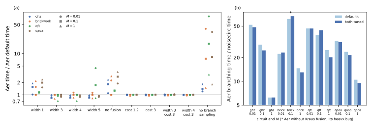

# Tuning Qiskit Aer's shot branching

## Question

noisecirc's parameters were tuned on the H100 ([Tuning noisecirc's parameters on the H100](parameter-tuning.md), [Error kernels and block sizes](error-kernels.md)), while Qiskit Aer ran with its defaults in the comparison of [noisecirc against Qiskit Aer and CUDA-Q](competitors.md). Which of Aer's options make its shot branching, noisecirc's closest competitor, faster, and how large is noisecirc's speedup when both simulators are tuned (PLAN.md task A11)?

## Approach

### Aer's options

Aer's shot branching shares one state among the shots of a branch until their Kraus choices differ; its options were taken from Aer 0.17.2's source (`src/transpile/fusion.hpp`, `src/simulators/circuit_executor.hpp`, `src/simulators/multi_state_executor.hpp`). Aer fuses gates and noise channels into Kraus operations, and when a circuit contains Kraus noise it halves its fusion width for the state-vector method, from 5 to 2 qubits. Three kinds of options can change the run time of shot branching on one GPU:

- **Fusion width**, `fusion_max_qubit`: the most qubits of one fused operation. Wider operations mean fewer operations, but a fused operation carries more Kraus matrices, and Aer computes the norm of each before it can assign the shots of a branch (half a pass each, see [noisecirc against Qiskit Aer and CUDA-Q](competitors.md)).
- **Fusion policy**: `fusion_enable` switches fusion off; `fusion_cost_factor` (default 1.8) weighs the estimated cost of a wider operation against the narrower ones it replaces.
- **Sampling of the final measurement**, `shot_branching_sampling_enable`: draws the outcomes of all shots of a branch from its final probabilities instead of branching on the measurement.

Other options do not apply here, according to the source:

- `cuStateVec_enable` is switched off by Aer itself whenever shot branching runs;
- `max_parallel_shots` and `num_threads_per_device` spread branches over device groups, and one GPU forms one group;
- `fusion_threshold` (14 qubits) only switches fusion off for smaller circuits;
- `max_memory_mb` limits host memory, while the number of branches held on the GPU follows from its memory (80% of it).

### Workloads and runs

The workloads are those of the A6 comparison: GHZ, brickwork, QFT and QAOA at 24 qubits with amplitude damping at loads $M$ = 0.01, 0.1 and 1 expected damping events per shot, 1000 shots, single precision on GPU 0 of bux (H100). Aer's shot branching ran with its defaults and with ten changed settings: widths 1, 3, 4 and 5, fusion off, cost factors 1.2 and 3, widths 3 and 4 with cost factor 3, and sampling off (`code/bench/a6_runs.py --aer-option`, two timed runs per point after an untimed one; runs over a minute were timed once).

The reference is noisecirc's branch `bench/fixes` (commit dd4b8c8), which contains the masked error kernels and the autotuning of [Error kernels and block sizes](error-kernels.md): its defaults, and its autotuning (`Simulator(autotune=True)`), which times one trajectory under six settings before the run (`code/bench/a2_runs.py`, five timed runs per point). Times are medians of the timed runs.

Tuned Aer is, per circuit, the setting with the smallest geometric mean time over the three loads, picked after the runs. This oracle choice favours Aer: noisecirc's autotuning picks its setting before the run, without knowing the result. Five points were repeated at 28 qubits: the loads at which Aer's shot branching fit into device memory in A6.

## Runs

LOG.md entries "A11 …" of 2026-10-24:

- Aer settings at 24 qubits: `data/20261024-1*-a11-aer-branch-*-n-24` (44 directories);
- noisecirc at 24 qubits: `data/20261024-153*-a11-noisecirc-*-n-24-5-reps`; the earlier two-run directories `…-a11-noisecirc-*-n-24` are superseded, because single runs of 10 to 30 ms carried outliers of up to 6 times (QFT at $M = 0.01$: 0.104 against 0.018 s);
- 28 qubits: `data/*-a11-*-n-28`, plus Aer's default at the QFT's $M = 0.1$ from A6 (`data/20261024-025454-a6-aer-branch-qft-n-28`, 134 s, not repeated).

The analysis is `code/bench/a11_analyze.py`, which writes `data/a11-analysis/a11.jsonl` and the figure below. Aer's defaults reproduced the A6 times within 3%.

## Results

### A fusion width of 3 qubits is Aer's best setting, 8% faster than its default (verified, 24 qubits)

Panel (a) below shows each setting's time over Aer's default at the 12 points. Panel (b) shows noisecirc's speedup with both simulators at their defaults and with both tuned.

Only the fusion width helps Aer, and only by a little. The geometric means over the 12 points, with their ranges:

| Setting | Time over default | Range |
|---|---|---|
| width 3 | 0.92 | 0.72–1.02 |
| width 4 | 0.94 | 0.72–1.14 |
| width 5 | 1.12 | 0.83–4.4 |
| width 1 | 1.49 | 1.00–2.4 |
| fusion off | 1.80 | 1.00–3.6 |
| cost factor 1.2 or 3 | 1.00 | 0.96–1.03 |
| width 3 or 4 with cost factor 3 | 1.00 | 0.97–1.04 |
| sampling off | 6.2 | 1.2–79 |

The best setting is width 3 for GHZ, brickwork and the QFT, and width 5 for QAOA (width 4 and 3 are within 2%). It saves 0 to 28% per point, 8% on geometric mean. The savings are largest at $M = 1$ (brickwork 19%, QFT 28%, QAOA 11%) and on GHZ at $M = 0.1$ (15%); at $M = 0.01$ they are 0 to 5%.

A cost factor of 3 cancels the wider width: the fusion then rarely builds three-qubit operations (QFT: 274 operations at width 3 with cost factor 3 against 143 with the default factor). Width 5 makes the QFT 1.9 times slower on average and up to 4.4 times at $M = 0.01$; the cause, presumably the cost of five-qubit Kraus operations, was not examined.

### Wider fusion trades fewer operations for more Kraus matrices (verified)

Aer's fusion output (`fusion_verbose`) shows why the gain stops at 3 qubits. Going from width 2 to 3 halves the number of fused operations, but each carries more Kraus matrices, and Aer computes a norm for each matrix it tries:

| Circuit at $M = 1$ | Operations, width 2 → 3 → 4 | Kraus matrices, width 2 → 3 → 4 |
|---|---|---|
| GHZ | 23 → 12 → 12 | 230 → 450 → 450 |
| brickwork | 150 → 84 → 80 | 1913 → 3308 → 3535 |
| QFT | 276 → 143 → 141 | 1204 → 1452 → 1529 |
| QAOA | 72 → 47 → 47 | 519 → 818 → 818 |

The operations applied, one pass each, fall by 1.5 to 1.9 times. The Kraus matrices, up to one norm (half a pass) each, rise by 1.2 to 2 times. The fusion widens to 4 qubits only on brickwork and the QFT, and even there the operations hardly drop further. Aer's state-dependent sampling of Kraus operators thus limits how much it can gain from fusion: the norm passes grow with every matrix that fusion adds. noisecirc avoids these passes by proposing its Kraus operators without the state.

### Both simulators gain similar amounts from tuning, so the speedup stays at 6 to 50 times (verified, 24 qubits)

noisecirc's autotuning saves −3 to 13% against its own defaults (4% on geometric mean), Aer's oracle-tuned width 0 to 28% (8%). noisecirc's speedup over Aer's shot branching therefore barely changes:

- **Defaults against defaults**: 6.2 to 61 times, geometric mean 25;
- **tuned against tuned**: 6.3 to 67 times, geometric mean 24;
- **per load, tuned against tuned**: 23 to 48 times at $M = 0.01$, 22 to 44 at $M = 0.1$ and 6.2 to 20 at $M = 1$.

The highest values belong to brickwork at $M = 0.1$ (61 and 67 times). There, Aer's Kraus fusion fails with its eigensolver error (`heevx`, see [noisecirc against Qiskit Aer and CUDA-Q](competitors.md)) at every fusion width tried, so Aer runs unfused in every setting. Without that point, the ranges are 6.2 to 52 (defaults) and 6.3 to 48 (tuned). The A6 range of 6 to 52 times is thus confirmed with both simulators tuned; noisecirc's default now also includes the masked kernels, so it is faster than in A6 (brickwork at $M = 1$: 1.63 against 2.06 s).

### At 28 qubits the tuned width helps Aer at one point and hurts at another (verified, five points)

At 28 qubits, width 3 changed Aer's time by −32 to +15% against its default:

| Circuit, $M$ | Aer default (s) | Aer width 3 (s) | noisecirc default (s) | noisecirc autotune (s) |
|---|---|---|---|---|
| GHZ, 0.01 | 1.81 | 1.61 | 0.117 | 0.117 |
| brickwork, 0.01 | 5.95 | 5.82 | 0.635 | 0.583 |
| QFT, 0.01 | 7.26 | 6.88 | 0.593 | 0.575 |
| QFT, 0.1 | 134 | 91 | 3.15 | 3.03 |
| QAOA, 0.01 | 2.95 | 3.40 | 0.332 | 0.279 |

Against the faster of Aer's two settings, autotuned noisecirc is 10 to 14 times faster at $M = 0.01$ and 30 times on the QFT at $M = 0.1$. With both at their defaults these factors are 8.9 to 16 and 43. Tuning does not change Aer's memory limit: its branches still have to fit on the device, so the 28-qubit points at which Aer crashed in A6 were not repeated.

## Caveats

- One GPU, amplitude damping, four circuits, 24 qubits with five points at 28; two timed runs per Aer point, one where a run took over a minute.
- Aer's tuned setting is an oracle choice in its favour; noisecirc's autotuning is not, and its tuning cost of 3 to 7 s per circuit is not included in its times (it is paid once per circuit, see [Error kernels and block sizes](error-kernels.md)).
- At 28 qubits Aer ran width 3 only; QAOA's best width at 24 qubits was 5.
- The mechanism behind the gain of wider fusion is inferred from Aer's fusion output and source, not from counted passes: `code/bench/aer_dryrun.py` was not rerun for the wider widths, because Aer's CPU fusion at 24 qubits took over 10 minutes per setting.
- Aer's `heevx` failure at brickwork, $M = 0.1$ is an Aer bug; no option tried avoided it.

## Verdict

Tuning Aer's shot branching gains about as little as tuning noisecirc. Of Aer's options that apply to one GPU, only the fusion width matters: 3 qubits instead of Aer's default of 2 for noisy circuits saves 8% on geometric mean and up to 28% at one expected error per shot. Every other option tried is neutral or slower, up to 79 times without sampling the final measurement. The gain stays small because each wider operation carries more Kraus matrices, and Aer computes a norm for each. With both simulators tuned, noisecirc remains 6 to 48 times faster than Aer's shot branching at 24 qubits (67 at the point where Aer's fusion fails) and 10 to 30 times at 28 qubits. The comparison in [noisecirc against Qiskit Aer and CUDA-Q](competitors.md) therefore stands with both simulators tuned.
