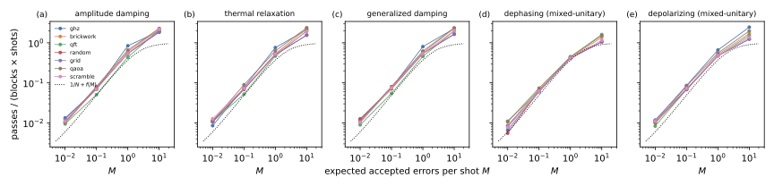
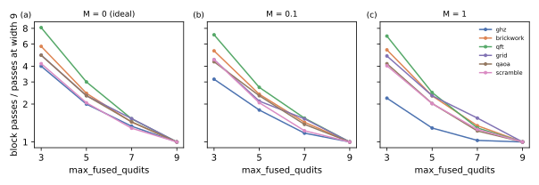

# Benchmark circuits and predicted work

## Question

Which circuits make a good benchmark of noisecirc, how should they be grouped into categories, and how do changes between categories, such as the noise strength or the degree of fusion, affect noisecirc's work (PLAN.md task A4)? This page answers it with predicted block passes, before the circuits are run; task A5 runs a selection to check the predictions.

## Approach

The [Block-pass cost model](../concepts/block-pass-cost-model.md) says which properties of a workload set noisecirc's work, and so suggests the axes along which benchmarks should differ:

1. **Fusion**: the number of blocks $B$ a circuit compiles into, which multiplies the passes of every trajectory.
2. **Noise type**: per gate-qubit channel, the error proposals $Z - 1$ and the accepted errors $\mu$, and the number of Kraus operators, which sets the cost of the general kernel.
3. **Noise load**: the expected accepted errors per shot $M$, which selects one of the three regimes of the pass count.
4. **Shots** $N$ and **register size** $n$, which scale the passes and the time per pass.

Seven circuits on noisecirc's gates (`code/bench/circuits.py`) cover the fusion axis; five qubit channels after every gate on each target (`code/bench/noise.py`) cover the noise axis. To compare circuits at equal error load, the strength is set per circuit and noise type from the target load, $p = M / ((\mu/p)\, C)$, with $C$ the circuit's gate-qubit channels. noisecirc's work is then predicted by the dry run of [Block passes against noisecirc's parameters](pass-count.md) at 28 qubits and 1000 shots (`code/bench/a4_predict.py`, `code/bench/a4_fusion.py`), and turned into times with the kernel-ratio model, Eq. (4) of the cost model, using kernel ratios measured at 28 qubits for each circuit and noise type (`code/bench/a4_times.py`).

## Runs

- Predictions for five noise types: `data/20261023-2*-a4-dry-run-predictions-{damping,thermal,gad,dephasing,depolarizing}/` (LOG.md "A4 dry-run predictions …").
- Fusion width at fixed load: `data/*-a4-dry-run-fusion-width-at-fixed-noise-load/`.
- Kernel ratios at 28 qubits: `data/20261023-212736-a2-block-pass-times-n-28/` (damping), `data/20261023-2336*-a5-block-pass-times-n-28-*` (thermal, generalized damping, scramble).
- Predicted times: `data/a4-figures/predicted-times.jsonl`, committed before the A5 runs finished; figures in `data/a4-figures/`.

## Results

### Circuit categories by fusion (verified, compiled circuits)

At 28 qubits, with noisecirc's tiles of 9 + 3 qubits, the circuits fall into three fusion categories:

| category | circuit | gates | channels $C$ | blocks $B$ | gates per block | blocks at width 3 / 9 |
| --- | --- | --- | --- | --- | --- | --- |
| chain | GHZ | 82 | 109 | 3 | 27 | 4.0 |
| width-limited | brickwork (1D, 15 layers) | 623 | 826 | 16 | 39 | 5.8 |
| width-limited | grid (2D, 28 cycles) | 1099 | 1414 | 30 | 37 | 4.9 |
| width-limited | QFT (all-to-all) | 434 | 812 | 19 | 23 | 8.1 |
| width-limited | QAOA (3-regular graph, 2 rounds) | 336 | 420 | 9 | 37 | 4.9 |
| width-limited | scramble (random pairs, 15 layers) | 630 | 840 | 21 | 30 | 4.2 |
| gate-count-limited | random (Qiskit, depth 28, on a line) | 13505 | 16278 | 112 | 121 | — |

Locality matters less than expected at this register size: a block of 12 of 28 qubits follows a light cone through many layers, so the scramble circuit, whose pairs are random and long-ranged, fuses almost as well as the 1D brickwork (30 against 39 gates per block). The categories differ more at narrow fusion (the last column: how many times more blocks width 3 needs than width 9), where the QFT fuses worst. The deep random circuit holds the maximum of 128 gates per block, so its block count is set by `max_operations`, not by its structure. At 28 qubits it also has more blocks than the device memory holds batches for, so noisecirc runs it with segments of 4 blocks.

### The noise load selects the regime, the noise type matters little (verified on dry runs)

At equal accepted errors per shot $M$, the passes per block and shot are nearly the same for all circuits and for all three non-mixed-unitary noise types, panels (a) to (c) below. They follow the three regimes of the cost model: about $1/N$ plus $M/2$ at $M \ll 1$, and above one at $M = 10$, where every shot has its own trajectory and error proposals add passes. The mixed-unitary channels, panels (d) and (e), have no or few rejections and stay closer to the bare curve $1/N + f(M)$ at strong load; depolarizing noise with noisecirc's default Kraus set still pays some rejections, see [Block passes against noisecirc's parameters](pass-count.md).

The noise type changes the time more than the passes, through the general kernel: generalized damping has 4 Kraus operators per qubit, and its general kernel is about 25% slower than that of damping (brickwork: 3.0 against 2.4 times $t_{bw}$). At $M = 1$, the predicted times of brickwork are 41 s (damping), 37 s (thermal) and 42 s (generalized damping).

### Fusion helps less as the noise grows (verified on dry runs)

Panel (a) below shows the passes at fusion widths 3 to 9 without noise: four to eight times as many at width 3. With noise, panels (b) and (c), the gain of wide fusion shrinks for circuits with few blocks: GHZ gains 4.0 times from width 3 to 9 without noise, but 2.2 times at $M = 1$. The reason is the error proposals, about $2MN$ passes for damping, which every trajectory makes whatever the fusion; they dominate once $B f(M)$ is comparable to $2M$.

### Predicted times at 28 qubits (prediction, checked in A5)

For 1000 shots and amplitude damping, the predicted times with the kernel-ratio model are:

| circuit | $M = 0.1$ | $M = 1$ |
| --- | --- | --- |
| GHZ | 0.6 s | 7.5 s |
| QAOA | 2.4 s | 20 s |
| QFT | 3.1 s | 27 s |
| scramble | 5.0 s | 40 s |
| brickwork | 5.1 s | 41 s |
| grid | 6.8 s | 50 s |
| random | 33 s | 250 s |

The bandwidth model predicts 1.2 to 1.8 times less for the same passes; which of the two predicts better is checked in A5.

## Representative circuits

For benchmarking noisecirc's algorithm against other simulators (task A6), the following workloads span the axes with few points:

- **Fusion**: GHZ (chain, few blocks), brickwork (local, many dense blocks), QFT (long-range, fuses worst at narrow width), QAOA (a problem circuit with sparse long-range gates), and the deep random circuit (gate-count-limited). The grid and scramble circuits behave like brickwork at 28 qubits and add little.
- **Noise type**: amplitude damping as the main non-mixed-unitary channel; thermal relaxation and generalized damping as variants with 3 and 4 Kraus operators; dephasing and depolarizing (with `optimize_kraus`) for the mixed-unitary comparison; ideal circuits for completeness.
- **Noise load**: $M$ = 0.01, 0.1 and 1 cover the single-trajectory, linear and saturated regimes; $M = 10$ is far beyond current hardware (10 damping events per shot).
- **Shots**: 1000, with 100 and 10000 to show where one trajectory serves all shots ($NM \ll 1$).

## Caveats

- All numbers here are predictions from dry runs and kernel ratios measured on single blocks; A5 checks them on the GPU for a subset.
- The surrogate's accepted fraction assumes uncorrelated single-qubit states; the strengths for a target $M$ use $\mu/p$ at a maximally mixed input.
- One register size (28 qubits) and the H100; at 28 qubits the device memory forces longer segments for circuits of many blocks (random, and narrow fusion widths).

## Verdict

Benchmark circuits should be classified by their block count (fusion), the noise by its load $M$ and only secondarily by its type. noisecirc's work is, to a good approximation, the blocks times the shots times a universal function of $M$, plus error proposals that grow with $M$ alone; fusion therefore helps most at weak and intermediate noise, and the choice of non-mixed-unitary channel changes the work by less than 40% at equal load. GPU runs of all seven circuits confirm the predicted passes within 14% and the predicted times within 33% ([Validation of the predicted work](validation.md)).
