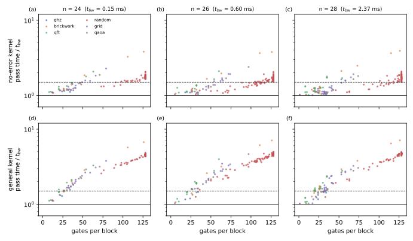
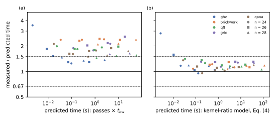
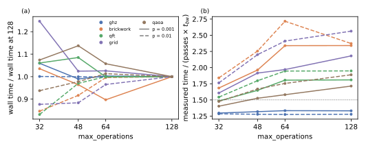

# Block-pass time on the H100

## Question

How well does the number of block passes times the time to read and write one state vector predict the runtime of a noisecirc simulation, Eq. (1) of the [Block-pass cost model](../concepts/block-pass-cost-model.md) (PLAN.md task A2)? PLAN.md asks for a regime where this approximation is off by at most a factor of about 1.5.

## Approach

All measurements ran on GPU 0 of bux, an H100 PCIe (80 GB, 1.7 TB/s measured), in `complex64` and exact mode, with amplitude damping after every gate on each of its targets (`code/bench/noise.py`) and 1000 shots. The bandwidth time $t_{bw}(n)$ is a CuPy in-place scaling of one state of $n$ qubits: 0.155 ms at 24 qubits, 0.60 ms at 26, 2.37 ms at 28. Registers below 24 qubits were left out, for two reasons: a state of 22 qubits (32 MB) fits into the H100's 50 MB L2 cache, where the CuPy floor reads 2.05 TB/s, more than the memory delivers; and a pass over one such state takes less than the about 50 µs the host needs per launch.

Four measurements separate the factors:

1. **Pass time of each block alone** (`code/bench/a2_blocks.py`): every distinct block of six circuits, compiled as noisecirc compiles them, timed on one state, both with the dominant (no-error) kernel and with the general kernel that switches on each gate's Kraus choice.
2. **End-to-end runs** (`code/bench/a2_runs.py`): wall time and noisecirc's diagnostics of whole runs at 24, 26 and 28 qubits and damping $p = 10^{-4}$ to $10^{-2}$, after a first run that compiles the kernels.
3. **Profiles** (`code/bench/a2_profile.py`): the same runs with timers around the kernel launches, the norm reads and the sampler's host steps, plus each launched kernel timed alone, which splits a run into GPU passes and host work.
4. **The block size** (`max_operations` = 32, 48, 64, 128), one parameter changed at 26 qubits.

The predicted time of Eq. (1) was compared with the measured time, and so was a refined prediction, Eq. (4) of the cost model, which weights the dominant- and general-kernel passes (counted by the dry run of [Block passes against noisecirc's parameters](pass-count.md)) with the circuit's mean kernel ratios from measurement 1 (`code/bench/a2_timemodel.py`).

## Runs

- Block pass times: `data/20261023-212608-a2-block-pass-times-n-24/`, `…-212635-…-n-26/`, `…-212736-…-n-28/` (LOG.md "A2 block pass times n=24/26/28"); figure and summary in `data/a2-figures/`.
- End-to-end on noisecirc `main`: `data/20261023-213022-a2-end-to-end-runs-n-24/`, `…-214014-…-n-26/`, `…-n-28-*` (LOG.md "A2 end-to-end runs …").
- Profiles: `data/20261023-222439-a2-profile-n-24/`, `data/20261023-222447-a2-profile-n-28/`, `data/20261023-222839-a2-profile-n-28-with-fix-squared-norms-parallel/`.
- End-to-end on `bench/fixes` (main with the fix below): `data/20261023-2230*-…-bench-fixes/` to `data/20261023-2255*-…-bench-fixes/` (LOG.md "A2 end-to-end runs … (bench/fixes)"); time model in `data/a2-timemodel/`.
- Block size: `data/20261023-23*-a2-max-operations-{32,48,64,128}-n-26-bench-fixes/`, figure `data/a2-figures/maxops.svg`.

## Results

### A noisecirc bug inflated every large-register timing (verified)

The first profile at 28 qubits showed that of a 35 s run only 17.7 s were passes: svpass summed each row's chunk sums with a single warp, about 4 ms per call at 28 qubits, and noisecirc reads the norms after every segment. The issue and its fix (branch `fix/squared-norms-parallel`, 1.7 times faster at 28 qubits) are described in [Issues found in noisecirc](noisecirc-issues.md), item 2. Everything below uses the branch `bench/fixes` with the fix.

### Pass times exceed the bandwidth time for large blocks (verified)

The time of a pass over one state depends on the block's size, not on the register size from 24 to 28 qubits. Panels (a) to (c) below show the dominant kernel, (d) to (f) the general kernel, relative to $t_{bw}$:

- The dominant kernel moves the state at the bandwidth up to about 40 gates per block. Blocks of 128 gates, as the deep random circuit has, take 1.5 to 2 times $t_{bw}$, and a few dense brickwork blocks of about 110 gates 3.5 to 4 times.
- The general kernel carries the code of every Kraus choice of every gate and grows linearly with the gates: about $1 + 0.03\,g$ times $t_{bw}$ for $g$ gates, 4.5 times at 128.
- Averaged over each circuit's blocks, the dominant ratio $r_{\text{dom}}$ is 1.1 (GHZ), 1.3 (QFT, QAOA), 1.4 (grid), 1.65 (random) and 1.7 (brickwork); the general ratio $r_{\text{gen}}$ is 1.3, 1.9, 2.0, 2.1, 4.4 and 2.6.

The H100 has 2.9 times fewer floating-point operations per byte of bandwidth than the RTX 4060 Ti (measured by svpass: 28 against 80) on which noisecirc's block size of 128 gates was tuned, which explains why large blocks are no longer bound by the bandwidth here.

### The bandwidth model is 1.2 to 2.6 times too fast at the default block size (verified)

Over 39 noisy end-to-end runs of five circuits (GHZ, brickwork, QFT, grid, QAOA) at 24 to 28 qubits, runs of at least 50 ms, the measured time is 1.24 to 2.58 times the passes times $t_{bw}$, geometric mean 1.81, panel (a) below. By circuit at 28 qubits: 1.35 to 1.47 for GHZ, 1.44 to 1.55 for QFT, 1.50 to 1.74 for QAOA, 1.6 for the grid, 2.1 to 2.4 for brickwork. The ratio does not depend much on the noise or the register size.

Weighting the dominant and general passes by the measured kernel ratios, Eq. (4) of the cost model, explains the times to 0.95 to 1.37 times, geometric mean 1.16, panel (b). The remaining 0 to 37% is host work: launching the kernels (about 0.1 ms per launch), proposing and accepting, and the measurement at the leaves, whose cumulative sums also take about 2.6 ms per call at 28 qubits. The profile at 24 qubits confirmed that the GPU passes make up 93% of a brickwork run at $p = 10^{-3}$.

### Smaller blocks bring the bandwidth model within about 1.5 and cost no time (verified at 26 qubits)

With `max_operations` = 32 instead of 128, the passes take closer to $t_{bw}$, panel (b) below: the measured time is 1.29 to 1.84 times passes times $t_{bw}$ (GHZ 1.3, QAOA 1.4 to 1.5, QFT 1.5, grid 1.6 to 1.8, brickwork 1.7 to 1.8), against 1.28 to 2.56 at 128. The wall time changes little, panel (a): at $p = 10^{-2}$, 32 gates per block is 6 to 17% faster than 128, because the error proposals, which take the expensive general kernel, do not become more numerous with smaller blocks, but each one becomes cheaper; at $p = 10^{-3}$ it is up to 25% slower (grid), because the extra blocks add dominant passes. The best block size thus depends on the noise strength.

## Caveats

- One device (H100 PCIe), one precision (`complex64`), one noise model for the end-to-end runs (amplitude damping after every gate), 1000 shots, exact mode. Other noise types change the general kernel (more Kraus choices per gate) and thereby $r_{\text{gen}}$.
- The kernel ratios are means over a circuit's blocks, not weighted by how often each block is passed; the time model is a check of the explanation, not a fit.
- Runs below about 50 ms (ideal circuits, very weak noise) are dominated by fixed costs and are not described by either model.
- The block-size study covers one register size (26 qubits) and two noise strengths.

## Verdict

On the H100, the time of a noisecirc run at 24 to 28 qubits is the block passes times $t_{bw}$ times a factor of 1.2 to 2.6 at noisecirc's defaults (geometric mean 1.8), and 1.3 to 1.8 with `max_operations` = 32. The bandwidth model is therefore a rough approximation, within PLAN.md's factor of 1.5 for GHZ, QFT and QAOA, and slightly beyond it (up to 1.8) for the grid and brickwork, whose blocks hold many dense gates; it improves to within 1.4 times when the dominant and general passes are weighted with measured kernel ratios. The regime used for the analysis in tasks A4 to A6 is therefore: at least 26 qubits, `bench/fixes`, and either `max_operations` = 32 with the bandwidth model, or the defaults with the kernel-ratio model. The noise-dependent best block size is an improvement opportunity for noisecirc.
