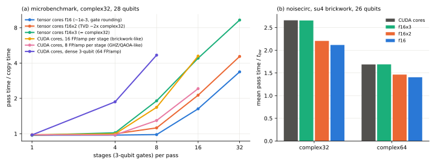

# Chained tensor-core stages and complex32

## Question

PLAN.md task A18 hands over a brainstorm on tensor cores (`PLAN_ADDITIONAL_NOTES_1.md`) and asks whether it holds promising ideas, especially for `complex32`, the storage of amplitudes as pairs of 16-bit floats ([Precision, block size and the instruction-bound pass](kernel-regime.md)).

[Tensor cores for block passes](tensor-cores.md) (A16) already answered the general question for noisecirc's five benchmark circuits: no tensor-core mode accurate to single precision is faster than the CUDA cores. This study tests what the brainstorm adds to A16.

## Approach

### What the brainstorm proposes, and what A16 already covered

The brainstorm's argument runs in five steps:

1. A complex $d \times d$ gate becomes a real $2d \times 2d$ matrix. From 3 qubits on, it fills the FP16 tensor-core instruction `mma.sync.m16n8k16`.
2. One gate per read and write of the state is memory-bound whatever unit computes it.
3. Several 3-qubit gates per pass, with the amplitudes kept on chip in between, raise the work per byte.
4. Dependent products then wait on each other. Several independent tiles per warp hide this latency.
5. The warpgroup instruction `wgmma` reaches more of the peak than `mma.sync`.

Steps 1, 2 and 5 are in A16: its stages use the real form, its blocks already apply many gates per pass, and its estimate for `wgmma` is unchanged. Three things are new:

- **Chaining in registers.** A16 moves every stage's amplitudes through shared memory and converts them between FP32 and FP16. The brainstorm keeps them in the tensor cores' register fragments from one gate to the next.
- **The pipeline question.** Whether such a chain keeps the tensor cores busy.
- **The focus on `complex32`.** A16 measured `complex32` with the least accurate mode (`f16`) only.

### Four measurements

1. **Integrated, `complex32`.** noisecirc's tensor-core stages (A16 implementation, branch `feature/tensor-cores`) in the modes `f16x2` (matrix split into two FP16 parts, amplitudes rounded to FP16 per stage) and `f16x3` (amplitudes split as well). Pass times of the five circuits at 26 qubits, accuracy at 24 qubits (`code/bench/a16_time.py`, `code/bench/a16_accuracy.py`).
2. **A microbenchmark of chained stages** (`code/bench/a18_chain.py`), outside noisecirc. A warp holds tiles of 128 amplitudes (7 qubits) of a `complex32` state of 28 qubits as `mma` operands and applies 1 to 32 dense 3-qubit gates per pass. Gates alternate between qubits 0 to 2 and 3 to 5.
   - **Variants:** one, two or four tiles per warp. The relayout between gates is done either in registers (`movmatrix`) or through shared memory, as at a stage boundary of noisecirc's tiles.
   - **Precisions:** the three FP16 modes: one product (`f16`), matrix split (`f16x2`), matrix and amplitudes split (`f16x3`).
   - **Comparison:** the same kernel on the CUDA cores, once with dense 3-qubit gates and once with structured stages of 4, 8 or 16 floating-point instructions per amplitude, the range of noisecirc's stages.
3. **Stage statistics.** Stages per pass and CUDA-core instructions per stage for the benchmark circuits, from svpass's cost model (`code/bench/a18_stage_counts.py`, CPU).
4. **A circuit of dense two-qubit gates.** The A16 implementation on `su4` brickwork, a new workload of generic dense two-qubit gates (`code/bench/gates.py`, `code/bench/circuits.py`), in `complex32` and `complex64`.

## Runs

LOG.md entries of 2026-10-26, each with its `data/` directory:

- "A18 f16x2 tensor-core stages complex32 sq4 n=26" and "A18 whole-circuit accuracy of f16x2 tensor-core stages complex32 n=24".
- "A18 register-chained 3-qubit gates tensor cores vs CUDA cores complex32 n=28" (one, two and four tiles), "A18 register-chained gates with f16x3 and shared relayout complex32 n=28", "A18 register-chained tensor-core vs structured CUDA-core stages complex32 n=28".
- "A18 stage counts and FP per stage of the A13 workloads" (CPU).
- "A18 dense su4 brickwork tensor-core stages" for `complex32` and `complex64`, 3- and 4-qubit stages; "A18 whole-circuit accuracy su4 brickwork tensor-core stages n=24"; "A18 hybrid f16x2 threshold complex32 sq3 n=26".
- Figure: `data/a18-analysis/chained-tensor-cores.svg` and `summary.json` (`code/bench/a18_summary.py`).

## Results

### In noisecirc's current tensor-core stages, f16x2 is slower in complex32 (verified)

| `complex32`, 4-qubit stages, 26 qubits | GHZ | brickwork | QFT | QAOA | grid |
| --- | --- | --- | --- | --- | --- |
| CUDA cores | 1.35 | 1.92 | 1.33 | 1.31 | 1.83 |
| `f16x2`, all stages | 1.75 | 2.39 | 3.07 | 2.11 | 2.67 |
| `f16x2`, stages above 18 instructions per amplitude | 1.34 | 2.33 | 1.28 | 1.26 | 2.40 |
| `f16`, stages above 12 instructions per amplitude | 1.41 | 1.78 | 1.31 | 1.58 | 1.83 |

Mean pass times over the bandwidth time $t_{bw}$. The modes' accuracy for the whole no-error trajectory at 24 qubits:

- **`f16x3`** reproduces `complex32` exactly, with total variation distances of $1.5$ to $5.5 \times 10^{-4}$.
- **`f16x2`** doubles them, to $1.9 \times 10^{-4}$ to $1.2 \times 10^{-3}$, with squared-norm errors up to $1.7 \times 10^{-3}$. Rounding the amplitudes to FP16 in every stage, instead of once per pass, adds random error. Unlike the gate rounding of `f16`, it does not accumulate.

### Chained in registers, tensor cores keep up to 16 dense gates per pass at memory speed (verified)

Panel (a) shows the microbenchmark with four tiles per warp and shared-memory relayouts. The pass time is relative to a plain copy of the state (1.76 TB/s). Measured:

| stages per pass | 8 | 16 | 32 |
| --- | --- | --- | --- |
| tensor cores `f16`, relayout in registers / through shared memory | 1.02 / 0.98 | 1.00 / 1.63 | 1.89 / 3.37 |
| tensor cores `f16x2` | 1.28 / 1.12 | 1.45 / 2.13 | 3.12 / 4.55 |
| tensor cores `f16x3` | 1.35 / 1.91 | 3.17 / 4.40 | 6.17 / 9.30 |
| CUDA cores, dense 3-qubit gates (64 FP/amp) | 4.67 | | |

The answer to the brainstorm's main question is yes, given several tiles per warp:

- **The tensor cores keep up.** With four tiles, 8 to 16 dense 3-qubit gates per pass cost nothing beyond reading and writing the state (`f16`, `f16x2`). The CUDA cores need 4.7 times the copy time for 8 such gates, about ten times more per gate.
- **The relayout is where the pipeline breaks.** Without a relayout the products reach 371 TFLOP/s, 77% of the measured `mma.sync` peak (483 TFLOP/s, itself 64% of the H100 PCIe's FP16 peak, as Luo et al. found for Hopper, [luo2025dissecting](../literature/notes/luo2025dissecting.md)). With relayouts in registers they reach about 230 TFLOP/s, through shared memory 130 to 200.
- **One tile per warp is latency-bound.** With 16 gates, `f16` takes 2.11 times the copy time with one tile, against 1.00 with four.
- **Accuracy.** Checked against NumPy at 12 qubits, `f16x3` is as accurate as FP32 arithmetic, so only the final `complex32` rounding remains. `f16x2` grows to $1.2 \times 10^{-3}$ over 32 gates. `f16` grows faster, because the same rounded gate matrix repeats its error.

### Against noisecirc's structured stages, only the reduced-accuracy modes win (verified)

noisecirc's stages are not dense. Their cheapest contraction order costs, per amplitude and 3-qubit stage, 18 instructions for brickwork, 14 for grid, 8.8 for QAOA, 8.0 for GHZ and 2.8 for QFT. A pass has 4 to 13 stages (brickwork 7.9, grid 9.1).

In the same streaming kernel at 8 stages per pass, the comparison is:

- **CUDA cores:** 1.68 times the copy time at 16 instructions per stage, 1.30 at 8.
- **Tensor cores:** 0.98 to 1.02 with `f16`, 1.12 to 1.28 with `f16x2`, 1.35 to 1.91 with `f16x3`.

So the brainstorm's design would shorten brickwork- and grid-like passes by about a quarter to a third, but only in `f16x2` or `f16`. In `f16x3`, the only mode as accurate as `complex32`, it does not. Stages of GHZ, QAOA and QFT are memory-bound on the CUDA cores already.

The streaming kernel is also not noisecirc's pass. noisecirc's tiles hold about 12 qubits shared by a thread block, and its stages act on arbitrary qubits of the tile. A relayout there needs a barrier over the whole thread block, not over a warp. The quarter to a third is therefore an upper estimate, and reaching it needs a new pass design:

- FP16 tiles in shared memory;
- stages chained in registers where their qubits allow;
- several tiles per warp.

### For circuits of dense two-qubit gates, noisecirc's tensor-core stages pay already (verified)

On `su4` brickwork, a circuit of generic dense two-qubit gates (26 qubits, 3-qubit stages), each stage costs 29 instructions per amplitude on the CUDA cores. The tensor cores win there even through A16's shared-memory path:

| su4 brickwork, 3-qubit stages | CUDA cores | `f16x3` | `f16x2` | `f16` |
| --- | --- | --- | --- | --- |
| `complex32`: pass time / $t_{bw}$ | 2.66 | 2.66 | 2.21 | 2.12 |
| `complex32`: total variation distance | $3.4 \times 10^{-4}$ | $3.4 \times 10^{-4}$ | $9.5 \times 10^{-4}$ | $1.3 \times 10^{-3}$ |
| `complex64`: pass time / $t_{bw}$ | 1.69 | 1.69 | 1.46 | 1.41 |

With 4-qubit stages the CUDA cores are slower (3.01 in `complex32`); `f16` then gains most (1.79), the others less.

The tensor cores can be restricted to the dense stages: `tensor_threshold` sends only stages that cost at least that many instructions per amplitude on the CUDA cores. With `f16x2` and a threshold of 24 (`complex32`, 3-qubit stages):

- **Default circuits:** unchanged, 0.98 to 1.00 of the CUDA cores' time (GHZ 1.21, brickwork 2.04, QFT 1.94, QAOA 1.38, grid 1.98).
- **su4:** 16% faster, 2.26 against 2.69.

`f16x2` is about as accurate as `complex32` storage (1.2 to 3 times its total variation distance) but not as accurate as `complex64`. It thus fits a `complex32` mode, not the default.

## Caveats

- **Setup:** one GPU (H100 PCIe), `mma.sync` only, amplitude damping, pass times of the dominant kernels, no whole runs.
- **The microbenchmark is idealized:** contiguous low qubits, warp-private tiles, gates alternating between two qubit triples, no squared-norm sums. Its structured CUDA-core stages are chains of real rotations, not noisecirc's generated code. Above 8 stages per pass their times are erratic: they rise faster than their instruction counts, likely from instruction-cache misses of the unrolled code, so the comparison is made at 8 stages.
- **The estimate is not implemented:** that a redesigned pass would shorten brickwork and grid passes by a quarter to a third rests on the microbenchmark.
- **Accuracy:** `f16x2`'s accuracy was measured for the no-error trajectory, not for sampled distributions.
- **One dense workload:** su4 brickwork with random Pauli coefficients. Circuits that fuse fewer dense gates per stage gain less.

## Verdict

The brainstorm is right about tensor cores, and its central proposal works when measured in isolation. Several 3-qubit gates per pass, chained in registers with several independent tiles per warp, keep the tensor cores fed: 8 to 16 dense gates per pass at memory speed in `complex32`, about ten times faster per gate than dense gates on the CUDA cores.

For noisecirc this changes the A16 verdict only at the margins:

- **Benchmark circuits:** their stages are structured and cost 3 to 18 instructions per amplitude, not 64. In noisecirc's current implementation no tensor-core mode is faster on them. A redesigned pass with stages chained in registers could shorten brickwork- and grid-like passes by up to a quarter to a third, but only with `f16x2`, whose error is up to 3 times that of `complex32`, or the less accurate `f16` (estimate).
- **Circuits of dense two-qubit gates:** noisecirc's existing tensor-core stages pay already. In `complex32` with `f16x2` and a threshold of 24 instructions per amplitude, su4 brickwork runs 16% faster and the benchmark circuits are unchanged.
- **Recommendation:** if noisecirc gets a `complex32` mode ([Recommendations](recommendations.md), item 3), `f16x2` tensor-core stages above that threshold are a cheap addition for circuits with dense two-qubit gates. A pass redesigned around chained tensor-core stages is a larger project with an estimated gain, ranked below first-jump sampling.
