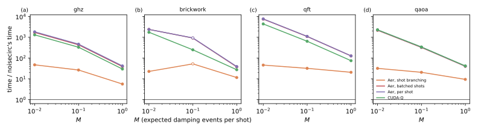
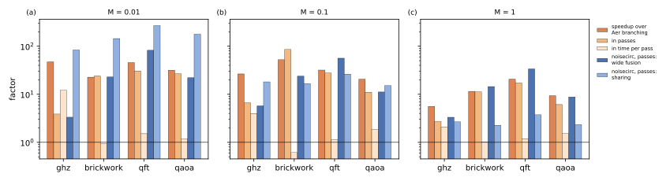

# noisecirc against Qiskit Aer and CUDA-Q

## Question

How much faster is noisecirc than other GPU state-vector simulators of noisy circuits, and how much of the difference comes from the algorithm, how much from the implementation (PLAN.md task A6 and goal)? The work of each simulator is translated into passes over the state vector, the unit of the [Block-pass cost model](../concepts/block-pass-cost-model.md), so that the algorithms can be compared independently of their implementation.

## Approach

### Simulators

The competitors are the GPU state-vector simulators with trajectory sampling of general Kraus channels that run in the project's environment, all in single precision on GPU 0 of bux (H100):

- **Qiskit Aer 0.17.2** (`qiskit-aer-gpu-cu11`), in three modes: shot branching, which shares one state among shots until their Kraus choices differ ([doi2023shots](../literature/notes/doi2023shots.md)); batched shots, which runs many shots in one kernel; and one trajectory per shot.
- **CUDA-Q 0.15.1**, target `nvidia` (cuStateVec), `fp32`, its trajectory simulation of noisy circuits, one trajectory per shot. Its documentation describes the state-dependent probabilities for general channels and, through cuStateVec Ex, qsim's delayed sampling with lower bounds ([isakov2021qsim](../literature/notes/isakov2021qsim.md)); trajectories are batched only up to 20 qubits.

cuStateVec Ex, which implements qsim's delayed lower-bound sampling, was compared later, in [noisecirc against delayed lower-bound sampling](lower-bound-sampling.md). Aer ran here with its default options; [Tuning Qiskit Aer's shot branching](aer-tuning.md) tunes them and repeats the comparison against tuned noisecirc, with the same range of speedups. qsim's GPU build was not included: it needs a CUDA toolkit to build and would add another per-shot simulator of the same algorithmic class as CUDA-Q.

### Workloads

GHZ, brickwork, QFT and QAOA of the [benchmark suite](benchmark-suite.md) with amplitude damping after every gate on each target, at loads $M$ = 0.01, 0.1 and 1 expected damping events per shot, 1000 shots, mainly at 24 qubits (state 128 MB, $t_{bw} = 0.155$ ms), where every simulator finishes within the 10-minute limit; the per-shot simulators ran 100 shots, and their times are scaled to 1000 (they are linear in the shots). Selected points were repeated at 28 qubits. noisecirc runs its branch `bench/fixes` with its defaults.

### Translating work into passes

The passes of each simulator are counted from its algorithm, not its timing:

- **noisecirc** reports its block passes.
- **Aer** is counted by `code/bench/aer_dryrun.py`, which follows Aer's `apply_kraus` (source read, see [Prior art](prior-art.md)) on the Kraus operations Aer actually applies (from Aer's `fusion_verbose` output) with the probabilities of the same surrogate as noisecirc's dry run. With noise, Aer fuses each gate with its channels into Kraus operations of at most two qubits (4 to 16 operators each); applying one costs a reduction over the state per norm it computes (half a pass) and one pass for the chosen operator; in shot branching, every branch computes norms until all its shots are assigned, and each new branch is a copy of the state (one pass).
- **CUDA-Q** is not counted from its source; its time per shot and gate is reported in passes.

To separate noisecirc's algorithmic ingredients, noisecirc itself was run with parts switched off (`code/bench/a6_variants.py`), which leaves the implementation unchanged: `k2` fuses at most 2 qubits without pinned qubits (Aer's fusion width), `pershot` runs every shot as a run of its own (no sharing between shots), and `pershot_k2` both, which is algorithmically closest to Aer's and CUDA-Q's one trajectory per shot.

Aer's fusion of Kraus operators fails on some noisy circuits with an eigensolver error (`heevx`, a known Aer bug that noisecirc's benchmarks also document); Aer then runs without Kraus fusion, which is slower. Of the points here, only brickwork at $M = 0.1$ ran so, in all three Aer modes; it is marked hollow below.

## Runs

LOG.md entries "A6 …" of 2026-10-24: `data/20261024-0*-a6-*` (24 qubits; `data/20261024-004312-a6-noisecirc-brickwork-n-24` is invalid, see LOG.md, and was rerun as `…-011201-…-rerun`), the noisecirc variants `data/*-a6-noisecirc-variant-*`, and 28 qubits `data/*-a6-*-n-28*`. The analysis, with all numbers below, is `data/a6-analysis/a6.jsonl` (`code/bench/a6_analyze.py`).

## Results

### noisecirc is 6 to 52 times faster than Aer's shot branching and 27 to 7700 times faster than per-shot simulation (verified, 24 qubits)

Panel by circuit below: the time of each competitor over noisecirc's, for 1000 shots.

- **Aer with shot branching**, the closest competitor, takes 6 to 52 times noisecirc's time: 21 to 52 times at $M = 0.01$ and 0.1, and 6 to 20 times at $M = 1$ (GHZ lowest, QFT highest).
- **Aer with batched shots or one trajectory per shot** takes 39 to 7700 times noisecirc's time; batching shots saves nothing at 24 qubits (each state fills the device).
- **CUDA-Q** takes 27 to 4400 times; its time does not depend on the noise strength.

The speedups shrink as the load grows, because noisecirc's sharing of trajectories, its largest gain, fades once most shots carry an error.

### The gain over Aer's shot branching is algorithmic (verified)

The speedup over shot branching factors into the ratio of passes and the ratio of time per pass (panel (a) to (c) below, orange bars). Aer's shot branching needs 3 to 86 times as many passes as noisecirc (2.7 to 30 at the points where Aer fuses as designed), while its time per pass is 1.0 to 2.1 times noisecirc's at $M = 1$ and up to 4 times at $M = 0.1$ (GHZ, where Aer's fixed cost per run still shows). The pass ratio comes from three algorithmic differences:

1. Aer fuses noisy gates into operations of at most two qubits, about 3 gates per operation on brickwork and 1.3 on the QFT, where noisecirc's blocks hold 9 + 3 qubits and 23 to 39 gates;
2. Aer computes the norm of each Kraus operator until all of a branch's shots are assigned, half a pass each, which noisecirc's state-independent proposals avoid;
3. Aer's branches stay in memory side by side, noisecirc's checkpoints depth-first; both share the prefixes of trajectories, but noisecirc additionally pays for rejected proposals.

At $M = 0.01$, Aer's shot branching also has a fixed cost of about 0.4 s per run, which dominates for short circuits (GHZ: 12 times noisecirc's time per pass).

### The gain over per-shot simulators is algorithmic too (verified)

noisecirc's variant `pershot_k2`, which simulates every shot on its own with blocks of at most two qubits, runs in 0.70 to 1.04 times the time of Aer's per-shot mode (where Aer fuses as designed) and 0.94 to 1.74 times that of CUDA-Q. At the same algorithm the implementations are therefore within a factor of 2; noisecirc's passes over blocks of two qubits take 1.3 to 2.9 times $t_{bw}$ (variant `k2`), Aer's per-shot passes 2.1 to 3.3 times. The whole difference to the per-shot simulators is algorithmic, and the variants split it into factors, counted in passes (blue bars above):

- **No norm passes**: Aer's per-shot passes are 1.46 to 1.5 times those of `pershot_k2`, the half pass per Kraus operation for the norm.
- **Wide fusion**: blocks of 9 + 3 instead of 2 qubits save 4 to 25 times the passes of every trajectory (QFT most, GHZ least), and 3 to 82 times with sharing.
- **Sharing of trajectories**: distinct trajectories and shared prefixes save 2 to 270 times, roughly $1/M$ at weak load as the [Block-pass cost model](../concepts/block-pass-cost-model.md) predicts (about 2/M per shot); at $M = 1$ it still saves 2.3 to 3.7 times.

The factors multiply to the measured pass ratios within their interplay: wide fusion saves more with sharing than without, as the shared passes are those of the blocks.

### At 28 qubits Aer's shot branching runs out of memory (verified)

Aer's shot branching keeps every branch's state on the device. At 28 qubits, a state takes 2 GB and the H100 holds about 35; with 1000 shots, about $1 + N(1 - e^{-M})$ branches arise, 11 at $M = 0.01$ and 96 at $M = 0.1$. Aer crashed (segmentation fault, no message) at $M = 0.1$ on GHZ, QAOA and brickwork and at $M = 1$ on the QFT. Where it ran, noisecirc was 8 to 41 times faster: at $M = 0.01$, Aer took 1.8 s (GHZ), 3.0 s (QAOA), 7.3 s (QFT) and 6.0 s (brickwork) against noisecirc's 0.13, 0.35, 0.60 and 0.67 s; at $M = 0.1$ on the QFT, 134 s against 3.3 s. noisecirc's depth-first traversal holds one batch per segment and ran all points. The per-shot simulators scale with the state: at $M = 0.1$ and 1000 shots (scaled from 20 shots), Aer per shot takes 316 to 2934 s and CUDA-Q 204 to 1439 s, 290 to 890 and 160 to 440 times noisecirc's time.

### The result holds for other shot counts and for thermal relaxation (verified, 24 qubits)

Two checks repeat parts of the comparison with one parameter changed (LOG.md entries "A6 shots …" and "A6 thermal …"):

- **Shots.** On the QFT and QAOA, Aer's shot branching took 10 to 21 times noisecirc's time at 100 shots (QFT at $M = 0.01$: 3 to 30 times, as noisecirc's two runs took 0.009 and 0.10 s), 21 to 46 times at 1000 and 11 to 55 times at 10000. Both simulators share trajectories, so neither gains more than the other from more shots; at 10000 shots and $M = 0.1$ Aer ran on 24 qubits without crashing.
- **Thermal relaxation** (damping and dephasing, three Kraus operators) at $M = 0.1$: noisecirc took 0.14 s on the QFT and 0.24 s on brickwork, against 5.0 and 4.5 s for Aer's shot branching (36 and 19 times), 145 and 77 s for Aer per shot (1000 and 330 times) and 80 and 56 s for CUDA-Q (570 and 240 times), close to the factors with amplitude damping.

## Caveats

- One device, single precision, four circuits, 24 and 28 qubits; amplitude damping throughout and thermal relaxation at one point per circuit; 1000 shots except the shot check. Two timed runs per point for noisecirc and Aer's shot branching at 24 qubits, one for the slower modes.
- Aer's passes are a model of its algorithm on a surrogate, checked indirectly: its time per counted pass is nearly constant over the loads (2.1 to 3.3 times $t_{bw}$ per shot, 2.1 to 2.8 with branching at loads of 0.1 and above, GHZ excepted), as it should be if the count is right; CUDA-Q's algorithm was not modelled.
- The brickwork point at $M = 0.1$ ran without Aer's Kraus fusion because of Aer's bug; it overstates noisecirc's advantage there by about 2.6 times (Aer per shot: 208 s without against 76 to 80 s with its fusion at the neighbouring loads).
- noisecirc's per-shot variants run 1000 separate runs, whose host overhead (about 10 ms each) inflates their times; their algorithmic factors are therefore given in passes.
- CUDA-Q batches trajectories only up to 20 qubits, so at 24 and 28 qubits it was measured without its batching.

## Verdict

noisecirc is one to almost four orders of magnitude faster than the GPU state-vector simulators tested, for amplitude damping on 24 to 28 qubits: 6 to 52 times faster than Aer's shot branching, its closest competitor, and 27 to 7700 times faster than per-shot trajectories in Aer and CUDA-Q. Nearly all of this is algorithmic: at equal algorithm the implementations are within a factor of 2 of each other. The algorithmic gain consists of wide fusion of noisy gates (4 to 25 times), sharing of trajectories (2 to 270 times, roughly $1/M$), and the absence of norm passes (1.5 times), all three made possible by proposing Kraus operators without the state; against shot branching, which also shares trajectories, the fusion and the missing norm passes remain, and noisecirc's depth-first memory bound lets it run where Aer's branches exhaust the device.
