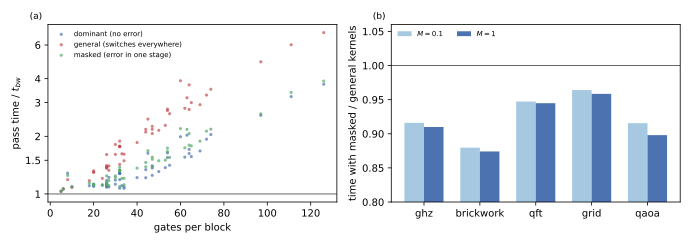

# Error kernels and block sizes

## Question

On the H100, the passes of trajectories with an error in a block used noisecirc's general kernel, which costs 1.3 to 4.5 times the bandwidth time, and a smaller block size helped at strong noise but hurt at weak noise ([Block-pass time on the H100](block-pass-time.md)). Can a kernel specialized to trajectories with few errors close the gap to the dominant kernel, and should the block size then be chosen per circuit or per noise strength (PLAN.md task A8)?

## Approach

### Why the general kernel is slow

A block's kernel applies its operations in stages, each stage loading the amplitudes of up to 3 qubits into registers, applying its operations and storing them (svpass's code generator). In the general kernel, every operation with several Kraus choices becomes a switch on the trajectory's choice, and each stage loads and stores the registers that any of the choices touches. A damping jump moves amplitude from $|1\rangle$ to $|0\rangle$, so even a stage of diagonal controlled phases loses its sparsity. The kernel pays for this in every stage, although a trajectory proposed with an error mostly deviates from the dominant (no-error) choices at a single operation.

### Masked kernels

The masked kernel keeps two bodies for every stage with choices: the dominant code, as the dominant kernel has it, and the switching code of the general kernel. A 64-bit stage mask per trajectory selects the body per stage; a thread block holds one trajectory, so the branch never diverges. It is implemented in svpass as blocks with default choices (`Block.with_defaults`; the mask travels as two more rows of the choices array, so the kernel's signature is unchanged) and used by noisecirc for every trajectory that leaves a block's dominant choices (`Block.masked_block`, `tunables.MASKED_ERROR_KERNELS`). Branch `feature/masked-error-kernels` of noisecirc (two commits, tests and documentation); svpass's tests (326, three new ones on both backends, including a block of more than 64 stages and the semantics of unflagged stages) and noisecirc's tests (179 plus the two statistical ones) pass on the H100.

### Block size and stage width per circuit

With masked kernels the error passes cost about as much as dominant ones, which removes the noise dependence of the best block size (see the results). The best settings then depend on the circuit only, and one trajectory's time ranks them: in the predictions of [Tuning noisecirc's parameters on the H100](parameter-tuning.md), the setting minimizing the sum of the blocks' dominant kernel times was the one minimizing the whole run's time, or within 0.3% of it, for all ten workloads. noisecirc's branch `feature/autotune` adds `Simulator(autotune=True)`: when a circuit is first compiled, it compiles the circuit with each pair of `max_operations` in (64, 96, 128) and `stage_qubits` in (3, 4), times one trajectory through the dominant kernels of each, and keeps the fastest pair for that circuit structure. It also exposes `stage_qubits` as a `Simulator` argument.

### Measurements

Every block's pass time with the dominant, general and masked kernel (a trajectory deviating at one operation) at 26 qubits (`code/bench/a7_blocks.py`); whole runs at 28 qubits with masked kernels on and off (`tunables.MASKED_ERROR_KERNELS`), and with autotuning, on GHZ, brickwork, QFT, QAOA and the grid with damping at $M = 0.1$ and 1, 1000 shots (`code/bench/a2_runs.py`).

## Runs

- Block times with masked kernels: `data/20261024-100152-a7-a8-block-times-with-masked-kernels-default/` and the other settings; figure `data/a8-analysis/masked.svg`.
- Masked kernels on and off: `data/20261024-*-a8-masked-kernels-{true,false}-*` (LOG.md "A8 masked error kernels: implementation and A/B").
- Autotuning: `data/20261024-*-a8-autotune-*` (LOG.md "A8 autotuning …").

## Results

### Masked kernels cost about a dominant pass (verified)

Panel (a) below: a pass of a trajectory deviating at one operation takes 1.0 to 3.9 times the bandwidth time with the masked kernel, a few percent above the dominant kernel (1.0 to 3.7), where the general kernel takes 1.0 to 7.0 times. The difference grows with the gates per block. Panel (b): whole runs are 4 to 13% faster with masked kernels (brickwork 12 to 13%, QAOA 8 to 10%, GHZ 8 to 9%, QFT 5%, grid 4%), with identical block passes, as the sampling is unchanged.

### The best block size no longer depends on the noise (verified)

With general kernels, blocks of 32 instead of 128 gates were faster at strong noise and slower at weak noise ([Block-pass time on the H100](block-pass-time.md)). With masked kernels, the predicted best block size of each circuit is the same at $M = 0.1$ and 1: 64 gates for brickwork (18 and 9% faster than 128), 96 for the grid at $M = 0.1$, the default for GHZ, QFT and QAOA ([Tuning noisecirc's parameters on the H100](parameter-tuning.md)). What remains is a dependence on the circuit, which a per-circuit choice covers without knowing the noise.

### Autotuning gains 6% on average, 14% on brickwork (verified)

Run end to end at 28 qubits, autotuning chose 64 gates and stages of 3 qubits for brickwork, 64 gates and 4-qubit stages for the grid and QAOA, and 64 or 96 gates with 4-qubit stages for the QFT (the choice for GHZ was not recorded). Against the defaults with masked kernels:

| circuit | $M = 0.1$ | $M = 1$ |
| --- | --- | --- |
| GHZ | 0% | 0% |
| brickwork | −14% | −14% |
| QFT | −3% | −7% |
| QAOA | −2% | −2% |
| grid | −13% | −2% |

That is 6% on average (geometric mean), against 4% for the best uniform setting of [Tuning noisecirc's parameters on the H100](parameter-tuning.md). Tuning costs one compilation and one timed trajectory per candidate, 3 to 7 s once per circuit at 28 qubits (the first run's time), which pays off from runs of about 30 s (brickwork) to a few minutes (QAOA, 2% gain) on.

### Together

Masked kernels and autotuning together make noisecirc 6 to 25% faster than its defaults on these workloads (brickwork 24 to 25%, grid 6 to 16%, QFT 8 to 12%, QAOA 11 to 12%, GHZ 8 to 9%), and remove the noise dependence of its best settings.

## Caveats

- One device (H100), amplitude damping, 28 qubits for the runs and 26 for the block times, 1000 shots.
- The masked kernel was timed for one deviating operation per trajectory; trajectories with errors in several stages run the switching code in each, at the general kernel's cost per such stage.
- Autotuning times the dominant kernels only; at strong noise on circuits whose error passes dominate, the ranking could differ, which the ten workloads did not show. It adds compile time for six candidate settings.
- The GHZ choice of autotuning was not recorded (the field was added to the runner after that run).

## Verdict

A kernel specialized to trajectories with few errors closes the gap between error and dominant passes: masked kernels cost about a dominant pass and make whole runs 4 to 13% faster, with no effect on the sampling. With them the best block size depends on the circuit, not on the noise, and per-circuit autotuning of block size and stage width gains another 0 to 14% (6% on average) at a one-time cost of seconds. Both are on noisecirc branches for review: `feature/masked-error-kernels`, and `feature/autotune` on top of it.
