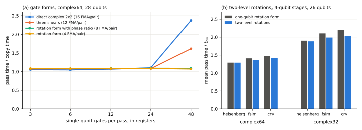

# Fewer instructions per gate

## Question

PLAN.md task A19 hands over a brainstorm on applying gates to state vectors with fewer floating-point operations (`PLAN_ADDITIONAL_NOTES_2.md`). It asks whether its ideas reduce arithmetic while keeping kernels efficient, and whether they generalize from dense one-qubit gates to sparse and to multi-qubit gates.

The brainstorm's main proposal is to write an $SU(2)$ gate as three complex shears, $U = \begin{pmatrix}1 & p\\ 0 & 1\end{pmatrix}\begin{pmatrix}1 & 0\\ q & 1\end{pmatrix}\begin{pmatrix}1 & r\\ 0 & 1\end{pmatrix}$ with $q = c$, $p = (a-1)/c$, $r = (d-1)/c$. This takes 12 fused multiply-adds (FMA) per amplitude pair instead of the 16 of the direct product. The brainstorm also notes that one gate per pass is bound by memory bandwidth, whatever its arithmetic.

## Approach

### What noisecirc already does

noisecirc applies one-qubit gates in svpass's **rotation form** ([Fewer instructions per block pass](block-instructions.md), A14). A gate, unitary or unitary times a diagonal, is factored as $D_L\,T\,D_R$:

- $T = \begin{pmatrix}1 & -t\\ t & 1\end{pmatrix}$ is a real two-term rotation, applied with one FMA per real output component: 4 per pair.
- $D_L$ and $D_R$ are diagonals, multiplied into a *pending diagonal* at generation time.
- Before each $T$, only the pending diagonal's ratio on the pair is applied. This is a complex multiplication of one amplitude, 4 instructions per pair, or none when the pending diagonal is symmetric on the pair.
- The rest of the pending diagonal is applied once at the end of the stage.

A one-qubit gate thus costs 4 to 8 instructions per pair, against 12 for the shears and 16 for the direct product.

The rotation form is close to a lower bound. Each output component of a gate that mixes two amplitudes depends on both, so it needs at least one instruction: 4 per pair, which $T$ attains. What remains above it is the bookkeeping of phases.

### What was tested

1. **The one-qubit forms on the GPU** (`code/bench/a19_gate_forms.py`, `complex64`, 28 qubits). Four forms are compared: direct (16 FMA per pair), shears (12), rotation (4), and rotation with its phase ratio (8). Each is run with one gate per pass, and with 3 to 48 gates per pass applied to amplitudes held in registers.
2. **Sparse multi-qubit gates: two-level rotations.** Many two-qubit gates rotate pairs of basis states and are diagonal elsewhere: controlled rotations, fSim and XX+YY gates, $\exp(-i\theta\,P \otimes P)$ for a Pauli $P$. The rotation form was generalized to every operation whose entries off the diagonal all lie on index pairs $(i, i \oplus m)$ for one bit mask $m$. Each $2 \times 2$ block becomes a real rotation between deferred diagonals.
   - **Implementation:** svpass `Config.two_level_rotations`, noisecirc branch `feature/two-level-rotations`, commit `d07b8c5`, off by default.
   - **Evaluation:** svpass's cost model, pass times and accuracy on three new workloads at 26 qubits (`code/bench/gates.py`, `code/bench/circuits.py`): a Trotterized Heisenberg chain (`rxx`, `ryy`, `rzz`, `rz`), a Sycamore-like grid of fSim gates, and brickwork of controlled RY gates.
3. **Dense two-qubit gates: the KAK decomposition.** Every two-qubit unitary is (local gates) × $N$ × (local gates), with a two-level $N$. Its pieces could all use the rotation form. The cost was evaluated with svpass's cost model (`code/bench/a19_kak_cost.py`); a first version that split gates inside svpass's code generator was removed again.
4. **Dense multi-qubit gates: Gauss's trick.** A complex product $(A + iB)(x + iy)$ can be formed from three real products instead of four: $Ax$, $By$ and $(A+B)(x+y)$. For a dense $d \times d$ matrix this costs $3d + 4$ instead of $4d$ instructions per amplitude. It was measured on dense 3-qubit gates in registers (`code/bench/a19_dense_forms.py`).

## Runs

LOG.md entries of 2026-10-26, each with its `data/` directory:

- "A19 single-qubit gate forms unrolled n=28". The earlier run "... direct shear rotation n=28" is invalid (LOG.md "A19 invalid gate-form timing (runtime gate loop)").
- "A19 FP cost of two-level rotations on new workloads" (CPU), "A19 two-level rotations" for `complex64` and `complex32` with 3- and 4-qubit stages, "A19 whole-circuit accuracy of two-level rotations n=24", "A19 error kernels with two-level rotations n=10".
- "A19 KAK split cost model" (CPU).
- "A19 dense 3-qubit gate direct vs Gauss three-product form n=28".
- Figure: `data/a19-analysis/gate-forms.svg` and `summary.json` (`code/bench/a19_summary.py`).

## Results

### The shears cost more than the rotation form noisecirc already uses (verified)

Panel (a) shows the pass time over the time of copying the state (1.76 TB/s).

- **One gate per pass:** all four forms take 1.01 times the copy time, as the brainstorm says.
- **Up to 24 gates per pass, in registers:** the arithmetic still hides behind memory.
- **Beyond that:** the cost per gate follows the instruction count. At 48 gates per pass, the direct form takes 2.37 times the copy time and the shears 1.62, while both rotation forms are still memory-bound (1.07 and 1.09).

| form | FMA per pair | time per gate and amplitude, saturated |
| --- | --- | --- |
| direct complex $2 \times 2$ | 16 | 0.42 to 0.45 ps |
| three shears | 12 | 0.31 ps |
| rotation form with phase ratio | 8 | 0.21 ps |
| rotation form | 4 | about 0.10 ps (from its count; still memory-bound) |

The shears save a quarter of the direct form's work, but noisecirc's rotation form saves half to three quarters of it. Replacing the rotation form by shears would add work.

The brainstorm's other points agree with the measurements:

- the multiplication-saving quaternion algorithm brings nothing on FMA hardware;
- fusing gates matters more than the form of one gate.

noisecirc's blocks already fuse.

### Two-level rotations: correct, but at most 8% faster (verified)

The generalized rotation form reproduces the stages in tests on the CPU (svpass's 284 tests pass, among them two new ones). On the GPU:

- **No-error trajectory:** unchanged accuracy at 24 qubits. Total variation distance $3$ to $4 \times 10^{-7}$ in `complex64` and $3$ to $5 \times 10^{-4}$ in `complex32`, as without the flag.
- **Error kernels:** within $2 \times 10^{-7}$ of svpass's NumPy reference at 10 qubits.

The gain is small:

| mean pass time / $t_{bw}$, 4-qubit stages | Heisenberg | fSim grid | CRY brickwork |
| --- | --- | --- | --- |
| `complex64`, one-qubit rotation form | 1.290 | 1.409 | 1.472 |
| `complex64`, two-level rotations | 1.289 | 1.356 | 1.414 |
| `complex32`, one-qubit rotation form | 1.901 | 2.105 | 2.201 |
| `complex32`, two-level rotations | 1.884 | 1.989 | 2.027 |

With 3-qubit stages the changes stay within 1% except fSim (3%). The floating-point instructions per pass drop by 0 to 6% (cost model, 4-qubit stages: Heisenberg unchanged, fSim 151.7 to 143.3, CRY 151.3 to 144.5).

The reason is that svpass's dense code already exploits these gates' structure. It skips zero entries and needs only one product for a real or imaginary one. Per amplitude, with damping after the gate:

| gate | dense code | two-level rotation form |
| --- | --- | --- |
| `rxx`, `ryy`, `rzz` | 4 | 4 |
| fSim | 3 | 3 |
| controlled RY | 2.5 | 2.5 |

The rotation itself costs 2 per amplitude, and the phase ratios and end diagonals the rest. The form gains only where a stage chains several such gates, so that their diagonals merge.

### Dense two-qubit gates: the KAK decomposition costs more (verified, cost model)

For random two-qubit unitaries followed by damping, svpass's cost model gives:

- **Dense matrix:** 16 instructions per amplitude.
- **KAK pieces in rotation form:** 24. Each of the five pieces, four local gates and the two-level $N$, costs its rotation plus a phase ratio.
- **With local gates merged into neighbouring gates**, leaving one local gate per qubit and $N$: 14 at best.

Applied to stages of one to four such gates on 3 qubits, the cheapest contraction order with the split is never cheaper than without (16, 32, 32, 32). Two or more dense gates on 3 qubits are cheapest as one dense $8 \times 8$ product.

Decompositions of larger unitaries into two-level rotations (Givens rotations) fare no better. The $d(d-1)/2$ rotations with their phases cost about $4(d-1)$ instructions per amplitude, against $4d$ for the dense matrix.

### Dense multi-qubit gates: Gauss's trick saves 3 to 7% (verified)

On dense 3-qubit gates in registers (`complex64`, 28 qubits), the three-product form is as accurate as the direct one ($1.9 \times 10^{-7}$ against $1.6 \times 10^{-7}$ after 4 gates). Its count promises 12.5% fewer instructions (28 against 32 per amplitude). Measured:

- **4 gates per pass:** both forms are memory-bound.
- **8 and 16 gates per pass:** the trick takes 3 and 7% less time (2.02 against 2.09 copy times at 8 gates, 4.47 against 4.81 at 16).

noisecirc forms dense products only where they are cheaper than the structured forms, mostly in circuits of dense two-qubit gates. The trick would shorten such stages by a few percent.

## Caveats

- **Setup:** one GPU (H100 PCIe), amplitude damping after every gate, pass times of the dominant kernels at 26 qubits, no whole runs.
- **The microbenchmarks are idealized:** amplitudes in registers, gates cycling over 3 qubits, no shared memory. In noisecirc's passes, arithmetic is one cost among several ([Precision, block size and the instruction-bound pass](kernel-regime.md)).
- **KAK is evaluated with the cost model only:** the version in the code generator was checked for correctness but not timed.
- **The new workloads are synthetic:** random angles, noise of 0.1 expected errors per shot.

## Verdict

The brainstorm's shear kernel would not reduce noisecirc's arithmetic. noisecirc's rotation form already applies a one-qubit gate with 4 to 8 instructions per amplitude pair, against 12 for the shears and 16 for the direct product, and its 4 is the minimum for a gate that mixes two amplitudes.

The generalizations measure as follows:

- **Sparse multi-qubit gates (two-level rotations):** implemented, correct, and 0 to 8% faster on circuits of controlled rotations and fSim gates with 4-qubit stages. svpass's dense code already exploits the zeros and real entries of these gates, so little is left. The flag is cheap and safe to merge with `stage_contraction`, but the gain is small.
- **Dense two-qubit gates (KAK):** more expensive than the dense matrix, because each piece pays its own phase bookkeeping. Not worth pursuing.
- **Dense multi-qubit gates (Gauss's three products):** 3 to 7% for chains of dense 3-qubit gates. A small gain for circuits of dense two-qubit gates, not for the benchmark circuits.

What remains above the instruction bound in noisecirc's stages is the bookkeeping of phases: the ratios before rotations and the diagonals at the end of stages. The bound is the same with any decomposition of a gate. Larger gains need fewer passes or fewer bytes per pass ([Recommendations for noisecirc](recommendations.md)).
