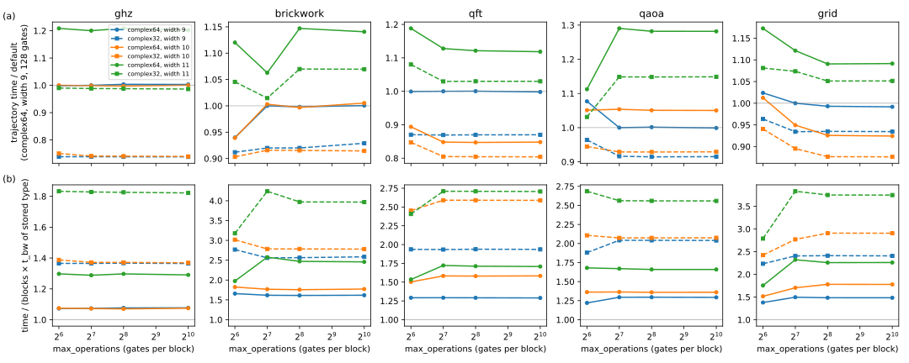
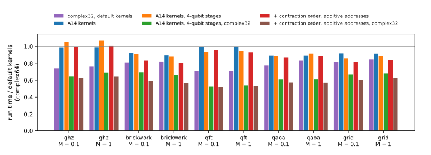

# Precision, block size and the instruction-bound pass

## Question

PLAN.md task A13 asks whether noisecirc can become substantially faster with the `complex32` data type and blocks as large as possible, a regime in which a block pass is expected to be limited by arithmetic rather than memory bandwidth, and how a kernel should be designed there. `complex32` is the precision that noisecirc and svpass already offer (`Simulator(dtype="complex32")`): each amplitude is stored as two 16-bit floats (4 bytes instead of 8) and computed in single precision in shared memory and registers. This task is the one place where the project leaves `complex64`, as A13 asks for it.

## Approach

The study has four steps, all on GPU 0 of bux (H100 PCIe) at 26 or 28 qubits with amplitude damping:

1. **What limits a pass now.** A static count of the work of each generated kernel per amplitude, without a GPU (`code/bench/kernel_ops.py`): floating-point instructions of the generated stages, and shared-memory accesses (svpass's `shared_accesses`). The counts of the 106 blocks timed in A7 and A8 were fitted against their measured pass times (`code/bench/a13_static.py`).
2. **Precision and block size with today's kernels.** Every block of five circuits (GHZ, brickwork, QFT, QAOA, grid; the A7 workloads at $M = 0.1$) was timed with its dominant and masked kernel for `complex64` and `complex32`, fusion widths `max_fused_qudits` of 9, 10 and 11 qubits, and `max_operations` of 64 to 1024 gates (`code/bench/a13_blocks.py`, 24 settings). The time of one trajectory, the sum of a circuit's dominant passes, measures the per-trajectory work.
3. **The same with kernels that issue fewer instructions.** The kernels of [Fewer instructions per block pass](block-instructions.md) (task A14) were timed in the same way, with 3- and 4-qubit stages, `complex32` and width 10 (7 settings).
4. **End to end.** Noisy runs at 28 qubits, $M = 0.1$ and 1, 1000 shots, of the default kernels, of `complex32` alone, and of the A14 kernels with and without `complex32` (`code/bench/a2_runs.py`); accuracy of `complex32` against `complex128` for the no-error trajectory of six circuits at 24 qubits (`code/bench/a13_accuracy.py`).

## Runs

- Static work against A7/A8 block times: `data/a13-static/` (LOG.md has no entry of its own for the recount; the measured times are those of LOG.md "A7 A8 block times with masked kernels …").
- Sweep with today's kernels: `data/20261024-1855*-a13-block-times-complex*` to `data/20261024-19*-a13-block-times-complex32-max-fused-qudits-11-max-operations-1024/`, analysis `data/a13-analysis/a13.jsonl`, figure `data/a13-analysis/a13.svg` (LOG.md "A13 block times …").
- Sweep with the A14 kernels: `data/20261024-191*-a13-block-times-fused-kernels-*` (LOG.md "A13 block times fused kernels …").
- Accuracy: `data/20261024-*-a13-complex32-accuracy-n-24/` (LOG.md "A13 complex32 accuracy n=24").
- End to end: `data/20261024-*-a13-a14-end-to-end-*-n-28/` (LOG.md "A13 A14 end-to-end …"), summary `data/a13-analysis/e2e.jsonl` and figure `data/a13-analysis/e2e.svg` (`code/bench/a14_e2e.py`).

## Results

### A pass is bound by issued instructions, not by bandwidth (verified)

The time of a pass over one state relative to the bandwidth time $t_{bw}$ is explained by the sum of two instruction streams, not by the larger of them:

$$\frac{t_{\text{pass}}}{t_{bw}} \approx \max\Bigl(1.17,\; 0.90\,\frac{F}{F_{bw}} + 0.81\,\frac{S}{S_{bw}}\Bigr), \tag{1}$$

with $F$ the floating-point instructions and $S$ the shared-memory accesses per amplitude, and $F_{bw} \approx 206$, $S_{bw} \approx 29$ the numbers of each that the H100 executes, at its measured peaks (46 TFLOP/s, 25.7 TB/s of shared memory), in the time $t_{bw}$ of one amplitude. Eq. (1) fits the 106 blocks within 12% (root mean square of the log ratio); the maximum of the three terms fits only within 24%. Both streams are issued by the same warp schedulers, which is why they add.

The default kernels of the benchmark circuits need 60 to 300 floating-point instructions and 10 to 25 shared accesses per amplitude: GHZ blocks sit at the memory floor, QFT blocks are dominated by shared accesses (13 stages of 3 qubits per block, 25 accesses), and brickwork, grid and QAOA blocks by arithmetic. This is the device dependence of [Block-pass time on the H100](block-pass-time.md) made quantitative.

### complex32 and larger blocks gain little per pass with today's kernels (verified)

Because most passes are bound by instructions, halving the bytes of a state shortens them little; the rest of a run gains more (next sections). Panel (a) below shows the time of one trajectory relative to noisecirc's defaults, panel (b) the time per pass relative to $t_{bw}$ of the stored type:

- `complex32` saves 4 to 15% of a trajectory (GHZ 26%), although it halves $t_{bw}$; its passes take 1.4 to 4.2 times its own $t_{bw}$.
- A fusion width of 10 qubits saves 15% on the QFT and 7% on the grid (fewer blocks, more gates each); width 11 is slower for every circuit, because a tile of $2^{14}$ amplitudes (128 KB) leaves one thread block per multiprocessor: GHZ, with the same three blocks, takes 2.32 instead of 1.93 ms.
- More than 128 gates per block changes nothing for these circuits: their blocks are limited by width, not by gate count.

### With fewer instructions per pass, complex32 pays (verified)

The kernels of task A14 apply the same blocks with 18 to 75% fewer floating-point instructions (see [Fewer instructions per block pass](block-instructions.md)). Wider stages of 4 qubits then cut the shared accesses by a third (QFT from 25 to 14 per amplitude) without the slowdown that 4-qubit stages caused in A7. With both, a pass sits close to the floor of Eq. (1) in `complex64`, so halving the stored bytes now shortens it. The time of one trajectory, relative to the default kernels in `complex64`:

| kernels | GHZ | brickwork | QFT | QAOA | grid |
| --- | --- | --- | --- | --- | --- |
| A14 kernels, 3-qubit stages | 0.99 | 0.89 | 0.99 | 0.85 | 0.86 |
| A14 kernels, 4-qubit stages | 1.09 | 0.87 | 0.89 | 0.88 | 0.84 |
| A14 kernels, 4-qubit stages, `complex32` | 0.67 | 0.71 | 0.60 | 0.55 | 0.70 |

### End to end: 1.45 to 1.9 times faster with complex32 and the A14 kernels (verified)

Whole noisy runs at 28 qubits confirm the trajectory times. Each cell is the median wall time over three seeds, relative to the default kernels in `complex64`:

| circuit, $M$ | `complex32` | A14 kernels | A14, 4-qubit stages | A14, 4-qubit stages, `complex32` |
| --- | --- | --- | --- | --- |
| GHZ, 0.1 / 1 | 0.74 / 0.76 | 0.99 / 0.99 | 1.05 / 1.07 | 0.65 / 0.69 |
| brickwork, 0.1 / 1 | 0.81 / 0.82 | 0.92 / 0.90 | 0.91 / 0.88 | 0.69 / 0.66 |
| QFT, 0.1 / 1 | 0.71 / 0.71 | 1.00 / 1.00 | 0.93 / 0.95 | 0.53 / 0.54 |
| QAOA, 0.1 / 1 | 0.78 / 0.83 | 0.89 / 0.89 | 0.89 / 0.92 | 0.61 / 0.61 |
| grid, 0.1 / 1 | 0.81 / 0.85 | 0.92 / 0.91 | 0.86 / 0.89 | 0.67 / 0.68 |
| geometric mean | 0.78 | 0.94 | 0.93 | 0.63 |

The figure shows the same ratios.

The A14 kernels alone save 0 to 11% in `complex64`. `complex32` alone saves 15 to 29% end to end, more than its 4 to 15% on the dominant passes of a trajectory, because a run also reads states for norms and sampling and copies them, which halves with the bytes. Together they save 31 to 47% (geometric mean 0.63, i.e. 1.6 times faster): the A14 kernels with 4-qubit stages add a factor of 0.81 on top of `complex32`, against 0.93 in `complex64`. The QFT gains most, because its passes were bound by shared accesses, which 4-qubit stages remove.

### complex32 is accurate to about 10⁻³, not to single precision (verified)

`complex32` stores each amplitude with an 11-bit significand, so every pass rounds the state to about $5\times10^{-4}$ relative; svpass scales the stored amplitudes by $2^{n/2}$ so that small amplitudes do not underflow. For the no-error trajectory through six circuits at 24 qubits, against `complex128`:

| precision | total variation distance of the probabilities | relative error of the squared norm |
| --- | --- | --- |
| `complex64` | $1.7$ to $5.0 \times 10^{-7}$ | up to $6.4\times10^{-6}$ |
| `complex32` | $1.5$ to $8.6 \times 10^{-4}$ | up to $4.7\times10^{-4}$ |

The squared norm is what noisecirc's acceptance uses, so in `complex32` the acceptance probabilities and the sampled distribution are biased by up to about $10^{-3}$. This is far below the statistical error of 1000 shots, but it is a bias, not noise: `complex32` sampling is exact only up to $10^{-3}$, while `complex64` is exact up to $10^{-6}$.

## How a kernel should be designed in this regime

The measurements give a clear rule for the design of a block's kernel on a device like the H100: **minimise the instructions issued per amplitude, arithmetic and shared accesses together, until the pass reaches the memory floor; then, and only then, shrink the bytes.** Applied to noisecirc:

1. Exploit the structure of the gates before fusing them into dense matrices. A dense matrix on $k$ qubits costs $8\cdot 2^k$ instructions per amplitude, so fusing pays only where the product is cheaper than its factors; real rotations between deferred diagonals cost 4 instead of 6 to 8 per one-qubit gate (task A14).
2. Use as few stages as the registers allow: every stage costs 2 shared accesses per amplitude, the price of about 16 floating-point instructions. With cheap arithmetic, 4-qubit stages pay; with today's arithmetic they did not (A7).
3. Shrink the stored type last: `complex32` shortens a pass only as far as it sits at the memory floor.
4. Larger tiles do not help: a block of more qubits holds more gates, and at the instruction bound its time grows with its gates, so the total over all blocks stays the same; tiles beyond $2^{13}$ amplitudes also cost occupancy.

Tensor cores, the obvious hardware for arithmetic-bound kernels, do not fit these circuits: they need dense stage matrices of 5 or more qubits, which cost more instructions than the structured gates they would replace, and single precision on them needs a three-fold split of every TF32 operand (estimate of the A15 brainstorm, [Directions beyond the current algorithm](new-directions.md); not measured).

## Caveats

- One device (H100 PCIe), amplitude damping, the five benchmark circuits, 26 qubits for the block sweeps and 28 for the runs.
- The fit of Eq. (1) uses static counts, a model of the instructions, not the compiled code; integer and address instructions are not counted and are part of the fitted coefficients.
- `complex32` is outside PLAN.md's general restriction to `complex64`; its accuracy is about $10^{-3}$ and its effect on sampling was checked for the no-error trajectory only.
- The A14 kernels are opt-in flags on the noisecirc branch `feature/stage-fusion` and need review before becoming defaults.

## Verdict

On the H100, noisecirc's passes are bound by issued instructions, the sum of arithmetic and shared-memory accesses, not by bandwidth. Therefore `complex32` shortens today's passes by at most 15% (GHZ 26%) and whole runs by 15 to 29%, larger blocks gain at most 15%, and width-11 tiles are slower. Once the kernels issue fewer instructions (task A14) and use 4-qubit stages, `complex32` makes whole runs 1.45 to 1.9 times faster than today's `complex64` defaults (geometric mean 1.6, against 1.28 for `complex32` alone), at an accuracy of about $10^{-3}$ instead of $10^{-6}$. The kernel design that pays in this regime is structure first, fewer stages second, fewer bytes last; dense fusion, larger tiles and tensor cores do not.
