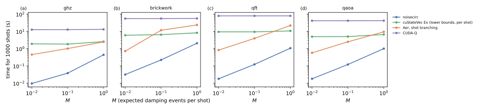

# noisecirc against delayed lower-bound sampling (cuStateVec Ex)

## Question

The closest prior art to noisecirc's state-independent proposals is qsim's delayed inner-product algorithm ([isakov2021qsim](../literature/notes/isakov2021qsim.md)), which NVIDIA's cuStateVec Ex implements on GPUs (see [Prior art of noisecirc's algorithm](prior-art.md)). It proposes a Kraus operator with probability *lower* bounds, the smallest singular values, and computes the exact probability from the state only when a random number falls above them; it therefore needs no norm pass for the no-error operator of amplitude damping most of the time, but it cannot share trajectories between shots, because each shot's choices may depend on its state. How does noisecirc compare with it, and how much of noisecirc's gain is the sharing of trajectories that its *upper* bounds permit (PLAN.md task A9)?

## Approach

cuStateVec Ex's state-vector updater (`SVUpdater`, cuQuantum Python 26.9.0, `cuquantum.bindings.custatevecEx`) applies a queue of matrices and channels with fusion of dense and diagonal matrices and the delayed sampling of general channels. `code/bench/a9_custatevec.py` enqueues each gate as a matrix (diagonal where it is) and after it a general channel of the damping on each of its targets, and simulates one trajectory per shot: reset to $|0\dots0\rangle$, apply the queue with fresh random numbers, sample one bit string. It runs in single precision on GPU 0 of bux, in a separate environment (`/local/venv-cuq`), as the project's environment pins other CUDA packages.

Correctness was checked against an exact density-matrix calculation: 20000 shots of the 4-qubit GHZ circuit with damping 0.2 and of the brickwork with damping 0.1 deviate from the exact distribution by a total variation distance of 0.008 and 0.007, at most 1.9 standard deviations in any outcome, consistent with sampling noise.

The comparison repeats the points of [noisecirc against Qiskit Aer and CUDA-Q](competitors.md): GHZ, brickwork, QFT and QAOA at 24 qubits, damping at $M$ = 0.01, 0.1 and 1 expected events per shot, 100 shots scaled to 1000 (the time per shot is constant). cuStateVec Ex's dense fusion size was varied from 3 to 6 at $M = 0.1$; its default was as fast as the best (5), so the default is reported. noisecirc's times and passes, including its variant without sharing (`pershot`), are those of A6 (branch `bench/fixes` before the masked kernels of [Error kernels and block sizes](error-kernels.md), which make noisecirc another 4 to 13% faster).

## Runs

LOG.md entries "A9 cuStateVec Ex …" of 2026-10-24: `data/20261024-*-a9-custatevec-ex-*`; analysis `data/a9-analysis/` (`code/bench/a9_analyze.py`).

## Results

### cuStateVec Ex is the fastest per-shot simulator, noisecirc 4 to 520 times faster still (verified)

For 1000 shots, cuStateVec Ex took 1.8 to 2.6 s (GHZ), 6.0 to 8.3 s (brickwork), 9.4 to 10.7 s (QFT) and 5.0 to 6.6 s (QAOA) (panels below). That is 7 to 15 times faster than CUDA-Q and than Aer's per-shot mode on the same circuits, and faster than Aer's shot branching at $M = 1$ except on GHZ, where both take 2.5 s (and at $M = 0.1$ on brickwork). Its time grows only slowly with the noise: each damping event whose random number falls above the lower bound costs a flush of the deferred operations and inner products, about 7 passes per event on brickwork.

noisecirc was 190 to 520 times faster at $M = 0.01$, 29 to 76 times at $M = 0.1$ and 4 to 10 times at $M = 1$.

### The gain splits into sharing and fewer passes per trajectory (verified)

Counting in passes over the state vector (its time per shot over $t_{bw}$), cuStateVec Ex makes 12 to 69 passes per shot: 0.1 to 0.2 per gate, from fusing up to 5 qubits and skipping almost all norm computations. noisecirc without sharing (variant `pershot`) makes 3 to 14 block passes per shot, each taking 1.3 to 2.5 times $t_{bw}$. noisecirc's speedup is the product of two factors, which reproduce the measured speedup within 10% at $M = 0.1$ and 1:

| circuit | per trajectory (wide fusion, kernels) | sharing at $M$ = 0.01 / 0.1 / 1 |
| --- | --- | --- |
| GHZ | 2.2 to 3.2 | 84 / 18 / 2.7 |
| brickwork | 1.6 to 1.8 | 144 / 17 / 2.3 |
| QFT | 2.7 to 2.9 | 269 / 26 / 3.7 |
| QAOA | 2.7 to 2.8 | 178 / 15 / 2.3 |

At $M = 0.01$ the product overestimates the measured speedup (by up to 1.8 times), as noisecirc's runs of 10 to 30 ms are dominated by fixed costs there.

So, against the best per-shot algorithm, nearly all of noisecirc's gain at weak and intermediate noise is the sharing of trajectories, which lower-bound sampling cannot do (15 to 270 times, roughly $1/M$), and the rest, 1.6 to 3.2 times, is noisecirc's wider fusion and its kernels per trajectory. Lower bounds do avoid the norm passes as noisecirc's upper bounds do, so against cuStateVec Ex noisecirc gains nothing from the missing norm passes, unlike against Aer (1.5 times, see [noisecirc against Qiskit Aer and CUDA-Q](competitors.md)).

## Caveats

- One register size (24 qubits), amplitude damping only, 100 shots per point; the comparison uses noisecirc's times of A6, measured in the same session but with the code before the masked kernels.
- cuStateVec Ex's passes are its time over $t_{bw}$, a measure of its work including its implementation, not a count of its algorithm.
- cuStateVec Ex applies the damping as single-qubit channels after each gate; Aer and CUDA-Q were given the tensor product on two-qubit gates, which is the same channel.

## Verdict

Delayed lower-bound sampling (cuStateVec Ex) is the strongest per-shot competitor found: it avoids the norm passes almost as noisecirc does and fuses up to 5 qubits, and it is 7 to 15 times faster than CUDA-Q and Aer per shot. noisecirc is still 4 to 520 times faster, and the decomposition shows why: lower bounds let a simulator skip the probability computation of a single trajectory, but only upper bounds with rejection let noisecirc propose all shots before simulating and share their trajectories, which accounts for 15 to 270 times at loads of 0.01 to 0.1 and 2.3 to 3.7 times at one error per shot.
