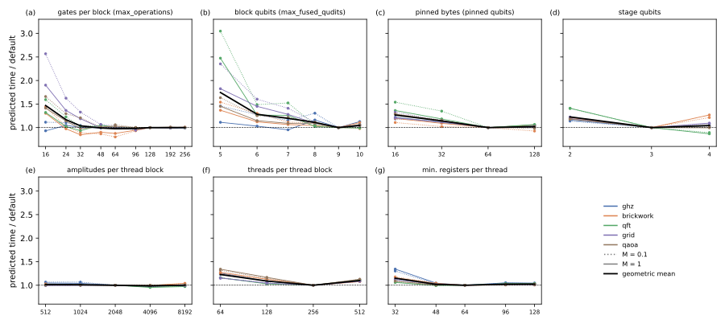

# Tuning noisecirc's parameters on the H100

## Question

noisecirc's parameters were tuned on an RTX 4060 Ti. Which settings are best on the H100, and how much can tuning them gain (PLAN.md task A7)? The parameters are the fusion settings of noisecirc and the kernel settings of its engine svpass:

- `max_fused_qudits`: qubits of a block besides the pinned ones (default 9);
- `max_operations`: gates per block (default 128, `tunables.MAX_OPERATIONS`);
- `pinned_bytes`: contiguous bytes every tile loads, i.e. the pinned lowest qubits (default 64 bytes, 3 qubits in `complex64`);
- `stage_qubits`: qubits of a stage, the operations a kernel applies together from registers (default 3);
- `group_amplitudes`: amplitudes a thread block holds in shared memory (default 2048);
- `threads`: threads per thread block (default 256);
- `min_registers`: registers per thread the compiler is held to (default 64).

The other tunables in `tunables.py` concern the Kraus optimization or are safety limits and do not change the run time of the default sampling; `max_oversampling` and `blocks_per_segment` were studied in [Block passes against noisecirc's parameters](pass-count.md).

## Approach

Measuring every setting end to end would take hours of GPU time, so the run time of each setting was predicted and only the best were run. The prediction combines two measured parts:

1. **Block times** (`code/bench/a7_blocks.py`): every block of a workload, compiled with the setting, timed on one 26-qubit state with its dominant kernel and its kernel for trajectories with errors.
2. **Passes per block** (dry run of [Block passes against noisecirc's parameters](pass-count.md), extended to count the dominant and the error passes of each block, `code/bench/dryrun.py`).

The predicted time is the sum over blocks of passes times block time (`code/bench/a7_predict.py`). The workloads are GHZ, brickwork, QFT, QAOA and the 2D grid at 26 qubits with amplitude damping at $M = 0.1$ and 1 expected events per shot and 1000 shots. One parameter was changed at a time (31 settings), first with noisecirc's general error kernels; after the masked error kernels of [Error kernels and block sizes](error-kernels.md), the promising settings and combinations were predicted again (13 settings), and the best were run end to end at 28 qubits (`code/bench/a2_runs.py`).

## Runs

- Block times, general kernels: `data/20261024-0*-a7-block-times-*` (31 settings; LOG.md "A7 block times …"); predictions `data/20261024-094143-a7-predicted-times-of-all-settings/`; figure and table `data/a7-analysis/`.
- Block times with masked kernels: `data/20261024-*-a7-a8-block-times-with-masked-kernels-*`; predictions `data/20261024-101021-a8-predicted-times-with-masked-kernels/`.
- End-to-end validation at 28 qubits: `data/20261024-1*-a7-validation-*`, against the masked-kernel runs `data/*-a8-masked-kernels-true-*` (LOG.md "A8 masked error kernels …").

## Results

### The defaults are close to the best on the H100 too (prediction)

Changing one parameter at a time, panels below, no setting is faster on average than the defaults by more than 2.5%:

- **Fusion width** (b): every narrower width is slower (11 to 75% on average), width 10 is 5% slower for noisy runs though 3% faster for a single trajectory.
- **Gates per block** (a): 64 and 96 are 2% faster on average, 32 and fewer slower; above 128 nothing changes, as no block reaches the limit except in the random circuit.
- **Pinned qubits** (c): 3 is best; 1 and 2 cost 27 and 14%, 4 costs 2%.
- **Stage qubits** (d): 3 is best on average; 2 costs 23%; 4 costs 4% on average but saves 11 to 13% on the QFT and costs brickwork up to 27% (40% with masked error kernels).
- **Amplitudes per thread block** (e): 4096 is 2% faster, the others within 2%.
- **Threads** (f) and **registers** (g): the defaults are best; 64 or 512 threads cost 10 to 23%, 32 registers 15%.

### Some circuits gain from other settings (verified at 28 qubits)

The best single change depends on the circuit: brickwork, whose blocks hold many dense gates, prefers 64 gates per block, the QFT stages of 4 qubits, the other circuits the defaults. Run end to end at 28 qubits, with masked error kernels:

| setting | GHZ | brickwork | QFT | QAOA | grid |
| --- | --- | --- | --- | --- | --- |
| `max_operations` = 64 | | −16 / −15% | | | |
| `stage_qubits` = 4 | | | −3 / −7% | | |
| `max_operations` = 96 | | | | | 0 / 0% |
| `max_operations` = 64, `group_amplitudes` = 4096 | 0 / 0% | −13 / −14% | 0 / 0% | −3 / −7% | 0 / −5% |

(Changes of the time at $M = 0.1$ / $M = 1$ against the defaults.) The combination of 64 gates per block and 4096 amplitudes per thread block is never slower than the defaults and saves 4% on average (geometric mean over the ten points); it is the best uniform setting found on the H100. The predictions from 26-qubit block times ranked the settings correctly for brickwork, but were off by up to 15% for the others (e.g. they expected the QFT to gain 14 to 21% from stages of 4 qubits, which saved 3 to 7%).

## Caveats

- Predictions at 26 qubits, validation at 28; one noise model (amplitude damping), 1000 shots.
- Compile times were not compared: kernels of blocks that two settings share come from the disk cache, which makes the measured compile times incomparable.
- One parameter at a time plus four combinations; interactions beyond those were not searched.

## Verdict

The parameters tuned on the RTX 4060 Ti remain close to the best on the H100: tuning gains 4% on average with one uniform setting (`max_operations` = 64, `group_amplitudes` = 4096), up to 16% for circuits with dense blocks (brickwork), and 7% for the QFT with wider stages. Larger gains came from the algorithm-level change of [Error kernels and block sizes](error-kernels.md), on which the per-circuit choice of these settings by autotuning builds.
