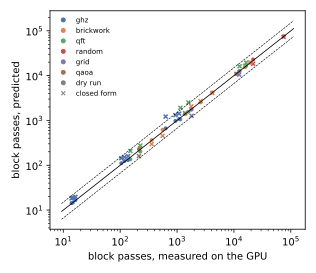
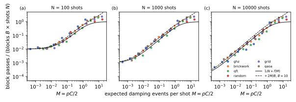
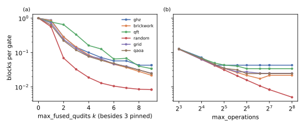
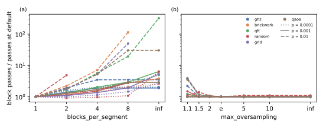

# Block passes against noisecirc's parameters

## Question

How do the circuit, the noise, the shots and noisecirc's parameters determine the number of block passes, the quantity that sets the runtime in the [Block-pass cost model](../concepts/block-pass-cost-model.md) (PLAN.md task A3)? The goal is to understand and predict the dominating behaviour without running the circuits.

## Approach

Two predictors of the block passes were built and checked against the passes that GPU runs actually made:

- **Dry run** (`code/bench/dryrun.py`). It executes noisecirc's own sampler (`sample()` of `bench/fixes`, unchanged) on the circuit's real blocks and batch sizes, but replaces each state vector by its squared norm. Propagating a state through a gate multiplies the norm by the gate's average acceptance on its targets: $\mathrm{tr}(M^\dagger M \rho)$ for the proposal-normalised Kraus operator $M$, where $\rho$ is each target qubit's state. The qubit states are tracked as pure single-qubit states from $|0\rangle$ as long as the gates leave them unentangled, and as maximally mixed afterwards. Tracking matters for circuits whose qubits wait in $|0\rangle$, such as the QFT, where the maximally mixed guess overestimated passes by up to 46%. A dry run takes 0.01 to 1 s per point on one CPU core.
- **Closed form** (`code/bench/a3_model.py`), Eq. (2) of the [Block-pass cost model](../concepts/block-pass-cost-model.md), with each block's oversampling factor $Z_b$ from the compiled circuit, an accepted fraction of one half of the error proposals, and the deduplication of error proposals that start from the same checkpoint and hit the same gate.

All sweeps use amplitude damping after every gate on each of its targets, 24 qubits, 1000 shots unless stated, and noisecirc's defaults otherwise, changing one parameter at a time. The circuits are the six of `code/bench/circuits.py`: GHZ (a chain), brickwork (1D, $n/2+1$ layers), QFT (all-to-all), a 2D grid ($n$ cycles), QAOA on a random 3-regular graph ($p = 2$), and Qiskit's random circuit transpiled to a line (depth $n$, 9009 gates at 24 qubits).

## Runs

- Validation: `data/a3-validation/` against the GPU runs of LOG.md entries "A2 end-to-end runs n=24", "n=26" and "n=28 …" (on `main`; passes do not depend on the later fix). LOG.md entry "A3 pass-count model validated against GPU runs".
- Fusion sweep: `data/20261023-214521-a3-dry-run-sweep-fusion-tracking-surrogate/`, LOG.md entry "A3 dry-run sweep fusion (tracking surrogate)".
- Noise and shots sweep: `data/20261023-214521-a3-dry-run-sweep-noise-tracking-surrogate/` (GHZ, brickwork, QFT, random; it timed out before grid and QAOA) and `data/20261023-223621-a3-dry-run-sweep-noise-grid-qaoa/` (grid, QAOA).
- Segment sweep: `data/20261023-220449-a3-dry-run-sweep-segment-tracking-guarded/`; oversampling sweep: `data/20261023-214521-a3-dry-run-sweep-oversampling-tracking-surrogate/`. Figures of both: `data/a3-figures/`.

## Results

### Both predictors match the measured passes (verified)

The dry run predicts the block passes of 30 GPU runs (24 to 28 qubits, damping $10^{-4}$ to $10^{-2}$) within 0.89 to 1.12 times the measured value, root mean square 1.05 times; it also predicts the batches and the split into dominant- and general-kernel passes (28-qubit brickwork at $p = 10^{-3}$: 3459 and 689 predicted, 3463 and 709 measured). The closed form is within 0.70 to 1.93 times, root mean square 1.3 times; its largest errors are GHZ at strong noise and the QFT, whose qubits sit in $|0\rangle$ for a while, where a damping jump cannot happen.

### Noise strength and shots: one curve for all circuits (verified on the dry run)

Normalised by the work of simulating every shot separately ($B$ blocks times $N$ shots), the passes of all circuits fall onto one curve of the expected number of accepted damping events per shot, $M = pC/2$ ($C$ the gate-qubit channels), as Eq. (3) of the [Block-pass cost model](../concepts/block-pass-cost-model.md) predicts:

$$\frac{P}{BN} \approx \frac{1}{N} + f(M) + \frac{2M}{B}, \qquad f(M) = 1 - \frac{1 - e^{-M}}{M}.$$

The curve has three regimes:

1. **Weak noise, $NM \ll 1$:** one trajectory serves all shots, $P \approx B$.
2. **Intermediate noise:** the passes grow linearly with the noise, $P \approx BN(M/2 + 2M/B)$. Shared prefixes save a factor $2/M$ against one trajectory per shot.
3. **Strong noise, $M \gtrsim 1$:** every shot has its own trajectory, $P \approx BN + 2MN$, and the term $2MN$ of rejected and accepted error proposals exceeds $BN$ once $M > B/2$ (GHZ, whose $B = 3$, lies above the curve there).

### Fusion sets the block count $B$ (verified)

The number of blocks multiplies every term but the rejected proposals. Panel (a) below shows the blocks per gate against the fusion width `max_fused_qudits`, panel (b) against `max_operations`. Two classes of circuits appear:

- **Width-limited circuits** (brickwork, grid, QAOA, QFT, GHZ): 7 to 20 blocks at 24 qubits, 0.02 to 0.04 blocks per gate. Their block count stops changing above `max_operations` = 32 to 64, so the default of 128 gates is not binding. Width 4 instead of 9 multiplies their blocks by 3 to 5.
- **Gate-count-limited circuits** (the deep random circuit): 75 blocks for 9009 gates, set by `max_operations` = 128 (about 120 gates per block); halving it doubles the blocks.

At damping $p \le 10^{-3}$ the noise does not change the fusion, because a block of ceiling $e$ would need about $1/p$ noisy channels.

### Segments and the oversampling limit (verified on the dry run)

noisecirc's default of one block per segment needs the fewest passes almost everywhere, panel (a) below. Longer segments lose prefix sharing and reject later: 1.3 to 3 times the passes at 4 blocks per segment and $p \le 10^{-3}$, and up to 100 times at $p = 10^{-2}$. Plain rejection sampling of whole trajectories (one segment) needs 2 to 7 times the passes at weak noise, and is hopeless at strong noise (more than $e^6$ proposals per shot for brickwork, grid and the random circuit at $p = 10^{-2}$). The only exception is the deep random circuit at $p = 10^{-4}$, where 2 blocks per segment need 9% fewer passes and 4 times fewer batches.

The limit `max_oversampling` on a block's ceiling only matters at $p = 10^{-2}$, panel (b): its default $e$ is within 5% of the best value of those tried; 1.1 and 1.5 split blocks and add passes. At 1.1 on the random circuit, the many small blocks no longer fit a batch per block into memory, so noisecirc falls back to longer segments without the limit.

### Noise type (verified for the channels' tables)

The noise enters only through two numbers per gate-qubit channel: the error proposals $Z - 1$ and the accepted errors $\mu$, both per shot in exact mode. From noisecirc's operation tables of an `r` gate followed by each channel (`code/bench/a4_noise_table.py`), relative to the strength $p$:

| noise | Kraus operators kept | $(Z-1)/p$ | $\mu/p$ |
| --- | --- | --- | --- |
| amplitude damping | 2 | 1.0 | 0.5 |
| thermal relaxation (damping and dephasing $p$) | 3 | 1.0 | 0.75 |
| generalized damping (excited population 0.2) | 4 | 0.8 | 0.5 |
| dephasing (mixed-unitary) | 2 | 0 | 0.25 |
| depolarizing (mixed-unitary), noisecirc's default Kraus set | 4 | 0.56 | 1.0 |
| depolarizing, `optimize_kraus=True` | 4 | 0.08 at $p = 10^{-3}$ | 1.1 |

Two consequences:

- For depolarizing noise, noisecirc's minimal Kraus set mixes the degenerate Pauli operators into non-unitary combinations, so this mixed-unitary channel still costs rejections; `optimize_kraus=True` removes nearly all of them.
- For generalized damping, `optimize_kraus=True` lowers $Z - 1$ by 19 to 25%, but raises $\mu$ by a factor of 2.4, so more trajectories become distinct: the unraveling with the fewest proposals is not the one with the most shared prefixes.

## Caveats

- The sweeps are dry runs; only the validation compares with GPU runs, at 1000 shots and for damping only. The dry run's surrogate assumes uncorrelated single-qubit states; it matched the GPU within 12% on all six circuit types tested, but other circuits (e.g. with long idle periods in superposition) may deviate more.
- The closed form assumes an accepted fraction of one half (the excited population of a maximally mixed qubit); it is a model for understanding, not for precise predictions (within a factor of 2).
- The noise-type table uses a maximally mixed input for $\mu$ and an `r` gate; for two-qubit gates the factors add per target.
- All runs are exact mode, `complex64`, qubits, damping after every gate.

## Verdict

The block passes of noisecirc are predictable without running a circuit: the dry run to about 10%, the closed form to a factor of 2. The dominant behaviour is Eq. (3) of the [Block-pass cost model](../concepts/block-pass-cost-model.md): the passes are the blocks $B$ times the shots $N$ times a universal function of the expected errors per shot $M$, plus $2MN$ passes for error proposals. noisecirc's defaults (one block per segment, `max_oversampling` = $e$) are close to optimal for the pass count; the circuit enters through $B$ (fusion) and $C$ (noise channels), the noise type through $(Z-1)/p$ and $\mu/p$. How passes translate into time is in [Block-pass time on the H100](block-pass-time.md); which circuits to benchmark follows in task A4.
