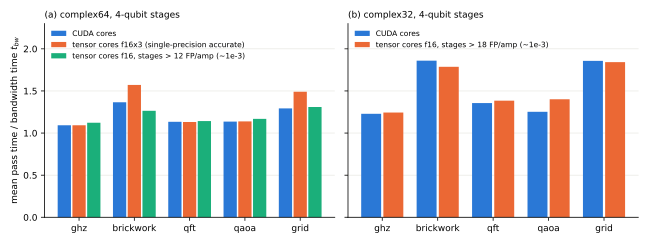

# Tensor cores for block passes

## Question

PLAN.md task A16 asks whether tensor cores can speed up the application of noisecirc's fused blocks. Tensor cores are the H100's units for small dense matrix products, with many times the arithmetic throughput of its ordinary (CUDA) cores, but only in low-precision input formats (TF32, FP16). [Precision, block size and the instruction-bound pass](kernel-regime.md) found that noisecirc's passes on the H100 are limited by the instructions they issue, arithmetic among them, which is the situation where tensor cores could help. That page also estimated, without measurement, that they would not fit. This study measures it.

## Approach

The study has four steps, on GPU 0 of bux (H100 PCIe) with amplitude damping and the five A13 workloads (GHZ, brickwork, QFT, QAOA, grid) at 26 qubits:

1. **Bound the gain.** If a stage's arithmetic cost nothing, a pass would still read and write its state and shared memory. The pass times of the best CUDA-core kernels, measured in A13, against the memory floor bound what any arithmetic unit can save.
2. **Build tensor-core stages into noisecirc.** A new option of svpass's code generator, `Config.tensor_cores` (noisecirc branch `feature/tensor-cores`), applies every stage of a block whose gates read no choice as one dense matrix on the tensor cores (see *How a stage maps onto the tensor cores* below). Six input precisions are available; `tensor_threshold` keeps cheap stages on the CUDA cores.
3. **Check accuracy.** One pass of every block on a random state, and the whole no-error trajectory of each circuit at 24 qubits, against `complex128` (`code/bench/a16_check.py`, `code/bench/a16_accuracy.py`).
4. **Time the passes.** The dominant kernel of every block, weighted by how often it occurs, for each variant (`code/bench/a16_time.py`); ablations that remove one part of the generated code at a time (`code/bench/a16_ablate.py`); and the peak throughput of the tensor-core instructions (`code/bench/a16_mma_rate.py`).

The baseline is the fastest CUDA-core kernel known: the cheapest contraction order of each stage (`stage_contraction`, A13), with 3- or 4-qubit stages.

### How a stage maps onto the tensor cores

A stage applies a $2^R \times 2^R$ complex matrix $U = A + iB$ to many register groups of $2^R$ amplitudes ($R$ = 3 or 4 register qubits). Tensor cores multiply real matrices, so the stage uses the real form

$$
\begin{pmatrix} \operatorname{Re} y \\ \operatorname{Im} y \end{pmatrix} = \begin{pmatrix} A & -B \\ B & A \end{pmatrix} \begin{pmatrix} \operatorname{Re} x \\ \operatorname{Im} x \end{pmatrix}, \tag{1}
$$

a $2^{R+1} \times 2^{R+1}$ real matrix times one column per register group. A warp issues `mma.sync` instructions that multiply 16 rows of this matrix with 8 register groups at a time: the shape m16n8k8 for TF32 inputs and m16n8k16 for FP16 inputs, both accumulating in single precision. Each stage is a dense product, whatever structure its gates have; diagonal gates cost as much as any other.

The inputs are rounded to TF32 or FP16, whose 11-bit significands give about $5 \times 10^{-4}$ relative error. The modes differ in how much of that they recover:

- **`tf32x3`, `f16x3`**: matrix and amplitudes are each split into a leading term and the rounded rest, and three products (leading × leading, leading × rest, rest × leading) restore single precision (Ootomo and Yokota, [ootomo2022recovering](../literature/notes/ootomo2022recovering.md)). Three times the work of one product.
- **`tf32x2`, `f16x2`**: only the matrix is split; the amplitudes are rounded once per stage. Two products.
- **`tf32`, `f16`**: both rounded. One product.

FP16 has a narrow exponent range, but svpass stores amplitudes multiplied by $2^{n/2}$ (the storage scale introduced for `complex32`), so the typical amplitude is near 1 and FP16 suffices.

## Runs

LOG.md entries are cited by title; each has its `data/` directory.

- Correctness and per-pass errors: "A16 tensor-core stages vs contraction kernels c64 sq3 n=26 ghz" and "... qaoa" (first version), "A16 tensor-core stages unroll 2/4/8 brickwork qaoa n=26".
- Ablations: "A16 ablation of tensor-core passes fixed cache f16 unroll 4 n=26 rerun", "A16 ablation of table-addressed tensor-core passes f16 unroll 2 n=26" and "... tf32x3 unroll 1 n=26". The earlier ablation runs are invalid (LOG.md "A16 invalid ablations (kernel cache)").
- Instruction throughput: "A16 mma.sync throughput on H100 GPU 0".
- Timing: "A16 tensor-core stages with preloaded tables sq3 n=26", "A16 tensor-core stages complex64 sq4 n=26", "... complex32 sq3 n=26", "... complex32 sq4 n=26", and the four "A16 hybrid tensor-core threshold ..." runs.
- Whole-circuit accuracy: "A16 whole-circuit accuracy of tensor-core variants n=24".
- Summary: `data/a16-analysis/summary.json` and the figure below (`code/bench/a16_summary.py`).

## Results

### Even free arithmetic could save at most a quarter of a pass (verified)

A pass cannot be faster than reading and writing its state: about 1.07 times the bandwidth time $t_{bw}$ in `complex64` (the GHZ blocks reach it) and about 1.2 in `complex32`. The best CUDA-core kernels take, as the mean over a circuit's blocks:

| circuit | GHZ | brickwork | QFT | QAOA | grid |
| --- | --- | --- | --- | --- | --- |
| `complex64`, best stages | 1.07 | 1.37 | 1.13 | 1.11 | 1.29 |
| `complex32`, 4-qubit stages | 1.23 | 1.86 | 1.36 | 1.25 | 1.86 |

In `complex64`, removing all arithmetic could thus save at most about 22% for brickwork, 17% for grid and 5% for the others. In `complex32` the room is larger for brickwork and grid (up to 1.5 times), because halving the bytes leaves the arithmetic a larger share. A pass that still moves its amplitudes through shared memory stage by stage, as a tensor-core stage does, keeps part of that cost, so the real bound is lower. The same argument limits tensor cores on any memory-bound kernel ([zhang2025can](../literature/notes/zhang2025can.md)).

### The tensor-core stages are correct, and the split modes are as accurate as single precision (verified)

All modes reproduce the `complex128` reference, including rows smaller than a tile (7 qubits). Over the whole no-error trajectory at 24 qubits:

| kernels | total variation distance | relative error of the squared norm |
| --- | --- | --- |
| CUDA cores, `complex64` | $1.6$ to $3.6 \times 10^{-7}$ | up to $3.7 \times 10^{-6}$ |
| tensor cores `tf32x3` | $0.2$ to $4.2 \times 10^{-7}$ | up to $5.4 \times 10^{-6}$ |
| tensor cores `f16x3` | $0.7$ to $5.6 \times 10^{-7}$ | up to $5.6 \times 10^{-6}$ |
| CUDA cores, `complex32` | $1.5$ to $5.5 \times 10^{-4}$ | up to $4.7 \times 10^{-4}$ |
| tensor cores `f16`, all stages | $3.3 \times 10^{-4}$ to $1.9 \times 10^{-3}$ | up to $1.5 \times 10^{-2}$ |
| tensor cores `f16`, stages above 12 instructions | $4.8 \times 10^{-6}$ to $1.3 \times 10^{-3}$ | up to $1.3 \times 10^{-3}$ |

Two observations:

- **The split modes match single precision.** The tensor cores round their accumulation toward zero, which shrinks each pass's squared norm by about $3 \times 10^{-7}$. Adding the leading products of later k-steps outside the tensor cores, as Ootomo and Yokota recommend, halves this bias, and over whole circuits it stays at the level of single-precision rounding.
- **A single FP16 product is less accurate than `complex32` storage.** The rounding of the gate matrix to FP16 is systematic: it repeats in every pass with the same matrix. For the QFT the norm drifts by 1.5%. Rounding only the amplitudes (`f16x2`) avoids this.

### Making tensor-core stages as fast as CUDA-core stages took four fixes (verified)

The first implementation was correct but 1.4 to 3 times slower than the CUDA cores. Ablations located the causes, one after the other:

1. **Latency.** A warp loaded 64 amplitudes, issued one product and stored the result, serially; the compiler does not move the next loads above shared-memory stores. Several tiles per iteration and a software pipeline (convert, multiply, load the next tiles, store) overlap the latencies.
2. **Instruction cache.** Every stage carried a never-executed CUDA-core fallback for tiny rows; removing it saved 0.23 $t_{bw}$ for brickwork. Small rows are now handled by predication.
3. **Address arithmetic.** A shared-memory layout free of bank conflicts for the tensor cores' access patterns flips 8 index bits, so computing addresses at run time cost about 380 integer instructions per stage. Tables of per-thread address parts, plus constants folded at generation time, removed most of them.
4. **Table loads after each barrier.** Loading a stage's matrix fragments and address table one stage ahead hides their latency.

After these fixes, an ablation of brickwork with FP16 and 3-qubit stages gives 1.52 $t_{bw}$ for the full kernel, 1.14 without the products and 1.20 for the kernel without any stage. Nearly all remaining cost is the tensor-core products themselves.

### The tensor cores' throughput is too low for dense stages at single precision (verified)

Measured on GPU 0 with independent products per warp, `mma.sync` reaches:

| instruction | TFLOP/s | relative to FP32 FMA on the CUDA cores |
| --- | --- | --- |
| m16n8k16, FP16 inputs | 483 | 11.6 |
| m16n8k8, TF32 inputs | 242 | 5.8 |
| FP32 FMA (CUDA cores) | 41.7 | 1 |

A dense stage in the real form of Eq. (1) costs $2 \cdot 2^{R+1} \cdot 2^{R+1} / 2^R = 8 \cdot 2^R$ floating-point operations per amplitude and product: 64 for 3-qubit stages, 128 for 4-qubit stages. noisecirc's structured CUDA-core kernels spend about 31 per amplitude and stage on brickwork (A13), because they exploit diagonal, sparse and rotation structure. The comparison is then:

- One FP16 product does about 2 times the work of the structured kernel at 11.6 times the rate: up to about 5 times faster arithmetic.
- The single-precision modes need 3 products: `f16x3` is at best about 2 times faster, `tf32x3` no faster at all. For brickwork with 3-qubit stages, `tf32x3` needs about 0.7 $t_{bw}$ of tensor-core time per pass even at peak, while the CUDA cores spend about 0.24 $t_{bw}$ on all stages.

Since peak rates are not reached inside a pass, the single-precision modes lose, and FP16 gains only where stages are arithmetic-heavy.

### Measured: a gain only for brickwork, and only at reduced accuracy (verified)

The figure shows the best variants with 4-qubit stages. In panel (a) the `f16x3` variant gives only stages above 24 instructions per amplitude to the tensor cores, which for GHZ, QFT and QAOA are none, so its bars there equal the CUDA cores'. The full set of variants:

| variant (`complex64`) | GHZ | brickwork | QFT | QAOA | grid |
| --- | --- | --- | --- | --- | --- |
| CUDA cores, 3-qubit stages | 1.07 | 1.44 | 1.29 | 1.11 | 1.34 |
| CUDA cores, 4-qubit stages, 96 registers | 1.09 | 1.37 | 1.13 | 1.14 | 1.29 |
| `tf32x3`, 3-qubit stages | 1.40 | 2.33 | 3.34 | 1.78 | 2.59 |
| `f16x3`, 3-qubit stages | 1.19 | 1.58 | 2.21 | 1.41 | 1.81 |
| `f16x3`, 4-qubit stages, all stages | 1.26 | 1.64 | 1.88 | 1.43 | 1.78 |
| `f16x3`, 4-qubit stages, stages above 24 | 1.09 | 1.57 | 1.13 | 1.14 | 1.49 |
| `f16`, 3-qubit stages | 1.11 | 1.40 | 1.93 | 1.24 | 1.48 |
| `f16`, 4-qubit stages, stages above 12 | 1.12 | 1.26 | 1.14 | 1.17 | 1.31 |

The numbers are mean pass times over $t_{bw}$ at 26 qubits. In summary:

- **Single-precision accuracy:** no tensor-core variant is faster than the CUDA cores on any circuit. `f16x3` is 15% slower on brickwork and grid; `tf32x3` up to 2.6 times slower.
- **FP16 inputs:** brickwork gets 8% faster in `complex64` (1.26 against 1.37) and 4% in `complex32` (1.79 against 1.86); the other circuits are equal or slower. The accuracy is then about $10^{-3}$, worse than `complex32` storage, which alone saves 15 to 29% of a run ([Precision, block size and the instruction-bound pass](kernel-regime.md)).
- **Diagonal-heavy circuits lose most.** QFT stages cost 3 instructions per amplitude on the CUDA cores and 64 to 128 as dense products.
- A side result: plain CUDA-core kernels with 4-qubit stages run 2 to 6% faster with a budget of 96 instead of 64 registers per thread (row 2 against the same stages at 64 registers, 1.15/1.44/1.16/1.16/1.33).

### Other forms of tensor-core work would not change this (estimate, not measured)

The user's hint for this task was to bring the work into a form that profits from the tensor cores' high throughput. Besides the unrolled, pipelined tiles and the wider stages measured above, three forms were considered:

- **Hopper's warpgroup instructions (`wgmma`)** have a higher peak, about 378 TFLOP/s for TF32 on this card. The single-precision modes would still need about 0.45 $t_{bw}$ of tensor-core time for brickwork, against about 0.24 $t_{bw}$ for all stages on the CUDA cores. `wgmma` also reads one operand from shared memory in a fixed layout, which a stage's scattered register groups do not have.
- **Wider stages** (5 or 6 qubits) mean fewer stages and fewer shared accesses. But the dense cost per amplitude doubles with each qubit, and the matrix fragments no longer fit into registers.
- **Batching trajectories** does not raise the work per byte: each amplitude still needs its own product.

Prior work uses tensor cores where the products are large and dense: tensor-network contractions ([ootomo2023quantum](../literature/notes/ootomo2023quantum.md)) and density-matrix superoperators in double precision ([li2024tanq](../literature/notes/li2024tanq.md)). HyQuas (ICS 2021) converts state-vector gate applications into GEMMs; its PDF could not be retrieved from the ACM library, so it is not cited here.

## Caveats

- One device (H100 PCIe), `mma.sync` only, amplitude damping, five workloads at 26 qubits; dominant kernels only (the masked kernels of error trajectories keep their choice stages on the CUDA cores).
- Pass times of single kernels, not whole runs. No end-to-end run was made, because no single-precision variant is faster per pass, and the FP16 variant is less accurate than `complex32` storage.
- The tensor-core implementation is a research prototype, tuned for about a day. Its remaining cost is mostly the products themselves, at about a third of the measured peak. A better schedule could reach more of the peak, but could not beat the bound of the first result.
- The accuracy figures are for the no-error trajectory; sampling with them was not tested.

## Verdict

Tensor cores do not speed up noisecirc's block passes at single-precision accuracy on the H100. The reasons are structural:

1. **Little room.** The passes of the best CUDA-core kernels are already within 1.07 to 1.37 times the memory floor in `complex64`, so even free arithmetic could save at most about 20%.
2. **Dense products waste work.** A stage applied as a dense matrix costs about twice the operations of noisecirc's structured kernels.
3. **Single precision triples it.** Recovering single precision from TF32 or FP16 inputs needs three products, which eats the tensor cores' 5.8 to 11.6 times higher throughput.

Measured, the single-precision modes (`tf32x3`, `f16x3`) are 15% to 2.6 times slower. A single FP16 product makes brickwork passes 4 to 8% faster, but at an accuracy of about $10^{-3}$, worse than `complex32` storage, which is the cheaper way to trade accuracy for speed. The implementation stays available as opt-in flags on the noisecirc branch `feature/tensor-cores` (`tensor_cores`, `tensor_unroll`, `tensor_threshold`, off by default).
