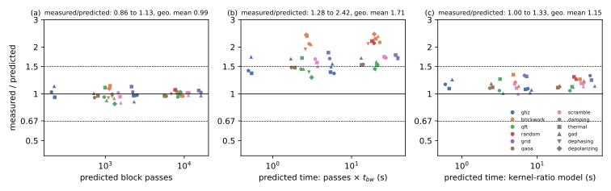

# Validation of the predicted work

## Question

Do the predictions of [Benchmark circuits and predicted work](benchmark-suite.md), made without running the circuits, hold when the circuits run on the GPU (PLAN.md task A5)? Each run reports its actual block passes, so the pass prediction and the time prediction can be checked separately.

## Approach

The predictions were committed before the runs finished (`data/a4-figures/predicted-times.jsonl`, and the dry runs in `data/*-a4-dry-run-predictions-*`). The runs repeat the predicted points on GPU 0 of bux (H100) with noisecirc's branch `bench/fixes` and its defaults, 28 qubits, 1000 shots, exact mode:

- all seven circuits of the benchmark suite with the three non-mixed-unitary channels (amplitude damping, thermal relaxation, generalized damping) at expected loads $M = 0.1$ and $M = 1$ (the deep random circuit only at 0.1, as $M = 1$ would take about 4 minutes per run);
- brickwork and QFT with the mixed-unitary channels (dephasing, depolarizing), and depolarizing with `optimize_kraus=True`.

Each point is the median of two timed runs (seeds 1 and 2) after a first run that compiles the kernels; runs whose first run took more than a minute (the `optimize_kraus` points) were timed once. `code/bench/a5_compare.py` matches every run with its prediction.

## Runs

The 27 runs `data/2026102[34]-*-a5-validation-*` (LOG.md entries "A5 validation …" of 2026-10-23 and 2026-10-24); the comparison in `data/a5-comparison/`. The kernel ratios for thermal and generalized damping were measured before the runs: `data/20261023-2332*-a5-block-pass-times-n-28-thermal/`, `…-gad/`, `…-damping-scramble/`.

## Results

### Block passes are predicted to within 14% (verified)

Over the 47 points with noisecirc's default Kraus operators, the measured block passes are 0.86 to 1.13 times the dry run's prediction, geometric mean 0.99 (panel (a) below). This holds for all seven circuits, all five channels and both loads, including the mixed-unitary channels.

### Times are predicted to within 33% by the kernel-ratio model (verified)

The kernel-ratio model, Eq. (4) of the [Block-pass cost model](../concepts/block-pass-cost-model.md), which weights the predicted dominant- and general-kernel passes with kernel ratios measured on the circuits' blocks, predicts the 39 non-mixed-unitary points within 1.00 to 1.33 times, geometric mean 1.15 (panel (c)); it consistently underestimates by the host's share of the run. The bandwidth model, passes times $t_{bw}$, is 1.28 to 2.42 times too fast, geometric mean 1.71 (panel (b)), as found in [Block-pass time on the H100](block-pass-time.md): within 1.5 times for GHZ, QFT and QAOA, 1.5 to 1.8 for grid and scramble, 2.1 to 2.4 for brickwork and the random circuit. For the mixed-unitary channels no kernel ratios were measured; their bandwidth ratios lie in the same range (1.3 to 1.5 for the QFT, 1.9 to 2.4 for brickwork).

### Noise type at equal load (verified)

At equal load the three non-mixed-unitary channels make the same passes within the prediction's accuracy, and generalized damping is 4 to 33% slower than amplitude damping (brickwork at $M = 1$: 50.9 s against 49.0 s; GHZ at $M = 0.1$: 0.92 s against 0.69 s, of which 18% more passes), from its general kernel with four Kraus operators per qubit. Dephasing, which needs no rejections, takes the fewest passes at $M = 1$ (brickwork: 6832 against 9317 for damping).

### `optimize_kraus` slowed the depolarizing runs (verified, fixed)

With `optimize_kraus=True`, depolarizing noise took more passes and time than without, the opposite of its purpose: the QFT at $M = 0.1$ made 6478 block passes instead of 980 to 1286 and took 40 s instead of 4 s; brickwork took 11.1 s instead of 6.4 s. The cause is a noisecirc issue, the optimizer spreading the no-error operator over several Kraus operators; it is described and fixed in [Issues found in noisecirc](noisecirc-issues.md), item 3. These four points are excluded from the figure.

## Caveats

- One register size (28 qubits), 1000 shots and two loads; the dry run's agreement at other shot counts was checked only at 1000 shots in [Block passes against noisecirc's parameters](pass-count.md).
- Two timed runs per point; the run-to-run spread of the passes reaches 30% at $M = 0.1$ (QFT with depolarizing noise: 980 and 1286 passes for the two seeds), which limits the comparison at weak load.
- The kernel ratios are means over each circuit's blocks, from one pass per block; the model ignores the host's share, which shows as the 0 to 33% underestimate.

## Verdict

noisecirc's work is predictable without running the circuits: the dry run predicts its block passes within 14% for all circuits, channels and loads tested, and the kernel-ratio model predicts its times within 33% from those passes. The bandwidth model alone is a factor of 1.3 to 2.4 too optimistic on the H100. The runs also exposed a third noisecirc issue, in `optimize_kraus`.
